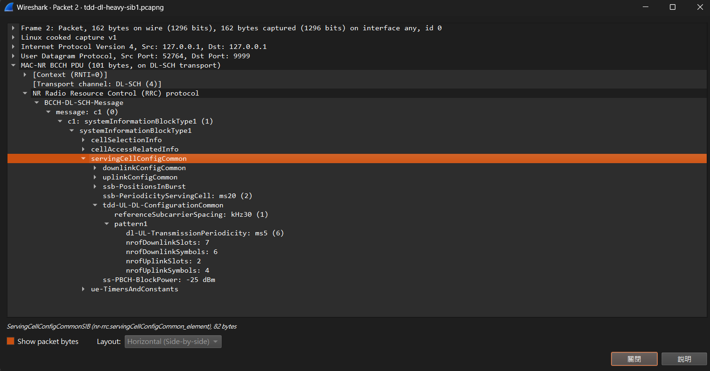
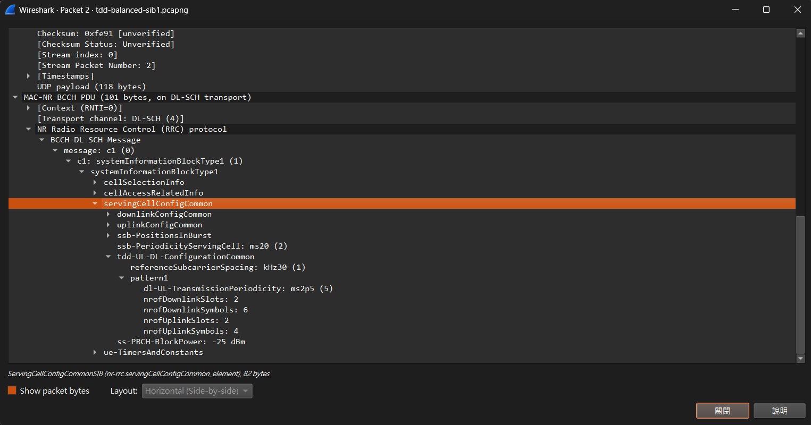
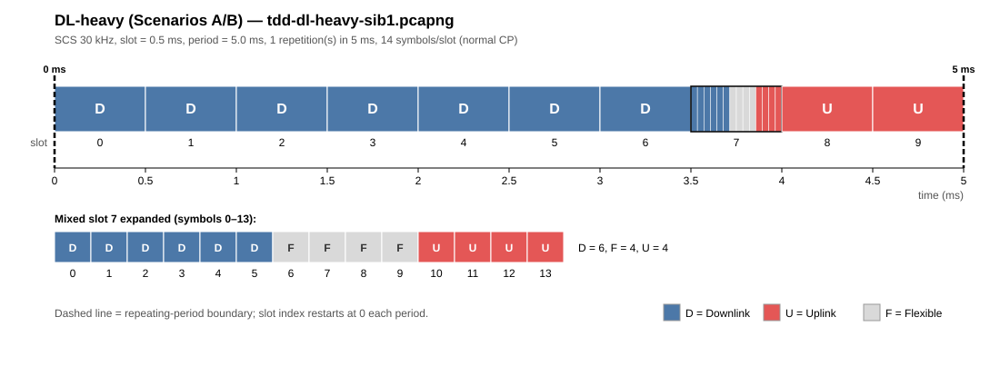
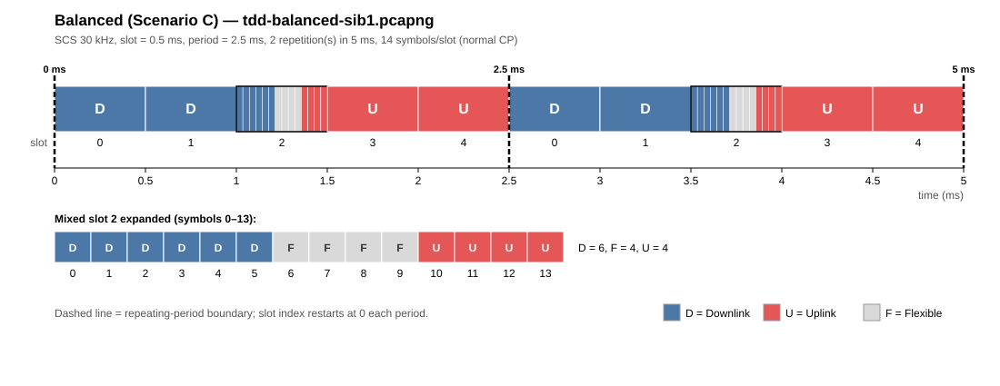
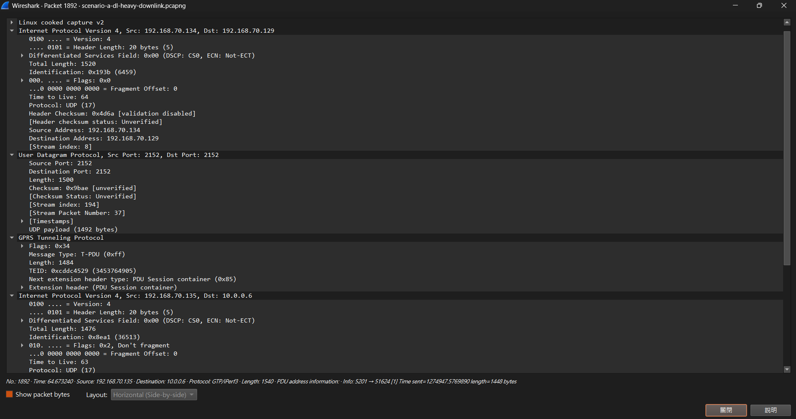
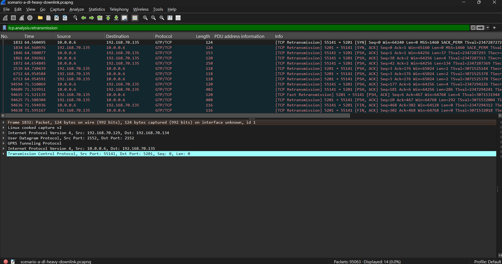
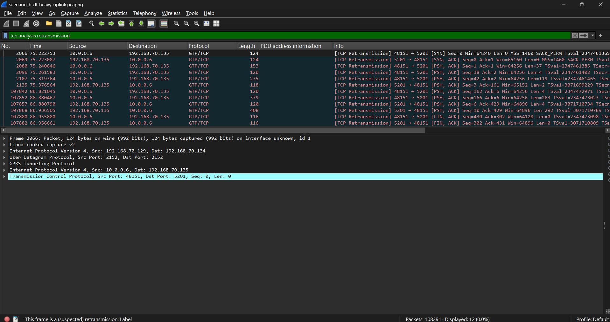
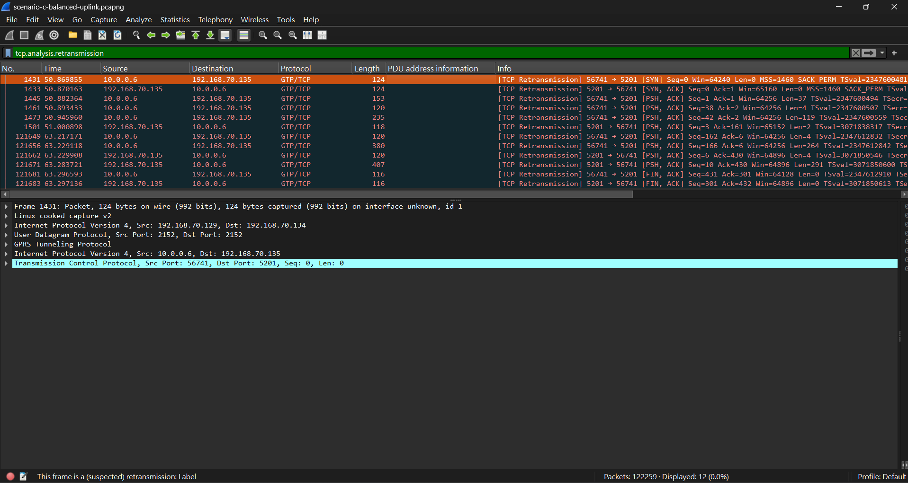
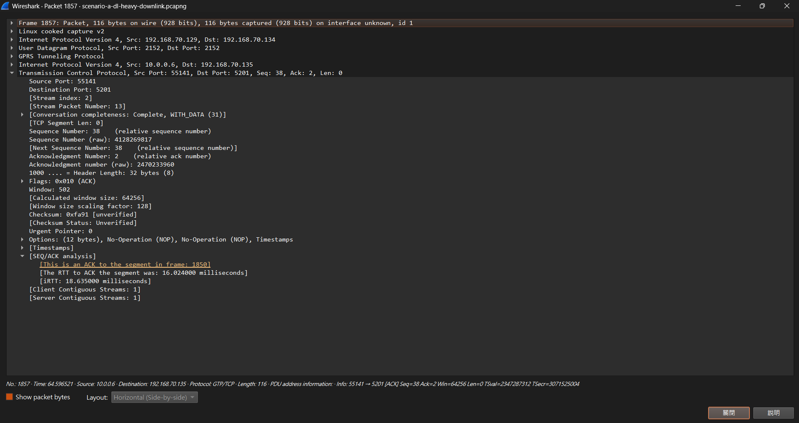
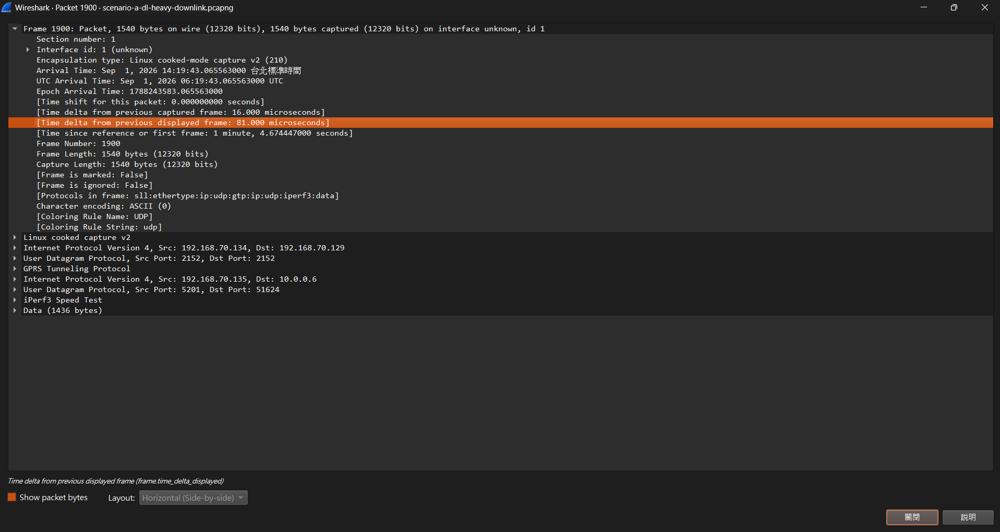

# Lab 2: gNB TDD Traffic Analysis

## Task 1 — Confirm the Traffic Direction

Source field: `start → test_start → reverse`

| Scenario | Reverse value | Direction |
| --- | ---: | --- |
| A | 1 | Downlink |
| B | 0 | Uplink |
| C | 0 | Uplink |

**Question:** Does the traffic direction shown in the JSON match the scenario description?

Yes. All three match the scenario descriptions. The `test_start` object of each JSON file shows the following:

- `scenario-a-downlink.json`: `"protocol": "UDP", "duration": 5, "reverse": 1`. The server sends to the client, which is downlink in this lab.
- `scenario-b-uplink.json`: `"protocol": "UDP", "duration": 5, "reverse": 0`. The client sends to the server, which is uplink.
- `scenario-c-uplink.json`: `"protocol": "UDP", "duration": 5, "reverse": 0`. The client sends to the server, which is uplink.

## Task 2 — Compare Throughput

Source field: `end → sum → bits_per_second`. Throughput (Mbps) = bits_per_second ÷ 1,000,000.

| Scenario | Direction | bits_per_second | Throughput (Mbps) |
| --- | --- | ---: | ---: |
| A | Downlink | 90,654,195.84 | 90.65 |
| B | Uplink | 109,117,249.69 | 109.12 |
| C | Uplink | 124,416,749.13 | 124.42 |

Improvement of C over B:

```text
Improvement (%) = (C - B) ÷ B × 100
                = (124.42 - 109.12) ÷ 109.12 × 100
                ≈ 14.02 %
```

Answers:

1. The downlink throughput in Scenario A is **90.65 Mbps**.
2. The uplink throughput in Scenario B is **109.12 Mbps**.
3. The uplink throughput is higher in **C** (124.42 Mbps) than in B (109.12 Mbps).
4. C improves over B by approximately **14.0 %**.

## Task 3 — Check the Trade-off

Source fields: `end → sum → lost_percent` and `end → sum → jitter_ms`.

| Scenario | Throughput (Mbps) | Packet loss (%) | Jitter (ms) |
| --- | ---: | ---: | ---: |
| B | 109.12 | 0.236 (111 / 47,102 packets) | 0.116 |
| C | 124.42 | 2.134 (1,146 / 53,704 packets) | 0.162 |

Answers:

1. **Yes.** C has higher uplink throughput than B: 124.42 Mbps compared with 109.12 Mbps, about +14.0 %.
2. **No.** C has higher packet loss than B: 2.134 % compared with 0.236 %, roughly 9 times higher, or 1,146 lost packets compared with 111.
3. Moving from B to C trades reliability for throughput. C delivers about 14 % more uplink throughput, but its packet loss rises by about 1.9 percentage points. Its jitter also rises, from 0.116 ms to 0.162 ms (about +39 %).

> Compared with Scenario B, Scenario C has **higher** throughput (+14.0 %), **higher** packet loss (0.236 % → 2.134 %), and **higher** jitter (0.116 ms → 0.162 ms). These results suggest that the balanced TDD setting provides more uplink transmission opportunities and therefore carries more uplink traffic. However, at this offered load the link is pushed closer to its limit, so more packets are dropped and the delay variation increases. More UL resources improved throughput but did not improve reliability in this test.

## Task 4 — Read SIB1 and Draw the TDD Configuration

MAC-NR-over-UDP heuristic decoding (`mac_nr_udp`) was enabled. SIB1 was located with the display filter `nr-rrc.systemInformationBlockType1_element`. The TDD fields were then read under `BCCH-DL-SCH-Message → c1 → systemInformationBlockType1 → servingCellConfigCommon → tdd-UL-DL-ConfigurationCommon`.

### 4.3 TDD Parameters (`pattern1`)

| Item | DL-heavy: A/B | Balanced: C |
| --- | --- | --- |
| Configuration capture filename | `tdd-dl-heavy-sib1.pcapng` | `tdd-balanced-sib1.pcapng` |
| SIB1 packet number | 2 | 2 |
| `referenceSubcarrierSpacing` (kHz) | 30 kHz (`kHz30`) | 30 kHz (`kHz30`) |
| `dl-UL-TransmissionPeriodicity` (ms) | 5 ms (`ms5`) | 2.5 ms (`ms2p5`) |
| `nrofDownlinkSlots` | 7 | 2 |
| `nrofDownlinkSymbols` | 6 | 6 |
| `nrofUplinkSlots` | 2 | 2 |
| `nrofUplinkSymbols` | 4 | 4 |
| Is `pattern2` present? | No | No |

**DL-heavy SIB1 (packet 2, `tdd-dl-heavy-sib1.pcapng`):**



**Balanced SIB1 (packet 2, `tdd-balanced-sib1.pcapng`):**



### 4.4 TDD Time Allocation Diagrams

With a reference SCS of 30 kHz, each reference slot lasts 0.5 ms.

```text
DL-heavy: 5 ms   ÷ 0.5 ms = 10 slots per period → 1 repetition in 5 ms
Balanced: 2.5 ms ÷ 0.5 ms =  5 slots per period → 2 repetitions in 5 ms
```

Construction of each period:

- **DL-heavy:** Slots 0–6 are full DL. Slot 7 is a mixed slot with symbols 0–5 = D, symbols 6–9 = F, and symbols 10–13 = U. Slots 8–9 are full UL.
- **Balanced:** Slots 0–1 are full DL. Slot 2 is a mixed slot with symbols 0–5 = D, symbols 6–9 = F, and symbols 10–13 = U. Slots 3–4 are full UL. This pattern repeats twice in 5 ms.





Text form (one letter per slot; `[...]` = mixed slot expanded to 14 symbols, `|` = period boundary):

```text
          0 ms                                                     5 ms
DL-heavy: | D D D D D D D [DDDDDDFFFFUUUU] U U |
Balanced: | D D [DDDDDDFFFFUUUU] U U | D D [DDDDDDFFFFUUUU] U U |
```

### Symbol Counts per Repeating Sequence

```text
DL-heavy: DL = 14 × 7 + 6 = 104,  UL = 14 × 2 + 4 = 32,  Total = 10 × 14 = 140,  F = 140 − 104 − 32 = 4
Balanced: DL = 14 × 2 + 6 =  34,  UL = 14 × 2 + 4 = 32,  Total =  5 × 14 =  70,  F =  70 −  34 − 32 = 4
```

| TDD setting | Repeating duration (ms) | Total reference slots | DL symbols | UL symbols | Flexible symbols | Configured UL symbol share (%) |
| --- | ---: | ---: | ---: | ---: | ---: | ---: |
| DL-heavy | 5 | 10 | 104 | 32 | 4 | 22.86 |
| Balanced | 2.5 | 5 | 34 | 32 | 4 | 45.71 |

### Symbol Counts over the Common 5 ms Interval

| TDD setting | Repeating duration (ms) | Repetitions in 5 ms | DL symbols in 5 ms | UL symbols in 5 ms | Flexible symbols in 5 ms |
| --- | ---: | ---: | ---: | ---: | ---: |
| DL-heavy | 5 | 1 | 104 | 32 | 4 |
| Balanced | 2.5 | 2 | 68 | 64 | 8 |

**Question:** Can two patterns have the same UL symbol count per period but provide different numbers of UL symbols per unit time?

Yes. Both configurations have exactly **32 UL symbols per period**: 2 full UL slots plus 4 partial UL symbols. The balanced period is only 2.5 ms long, however, while the DL-heavy period is 5 ms. In the same 5 ms interval, the balanced pattern repeats twice and provides **64 UL symbols**, compared with **32** for DL-heavy. That is twice the configured UL resource per unit time, which is also reflected in the UL symbol share (45.71 % vs. 22.86 %). The raw per-period count alone is therefore misleading; the period length must also be considered.

### 4.5 Connect SIB1 to the Performance Results

| Scenario | Reference TDD setting | JSON traffic direction | Configured UL symbol share (%) | Throughput (Mbps) | Packet loss (%) |
| --- | --- | --- | ---: | ---: | ---: |
| A | DL-heavy | Downlink (`reverse: 1`) | 22.86 | 90.65 | 0.443 |
| B | DL-heavy | Uplink (`reverse: 0`) | 22.86 | 109.12 | 0.236 |
| C | Balanced | Uplink (`reverse: 0`) | 45.71 | 124.42 | 2.134 |

Answers:

1. **Differing parameters:** Only `dl-UL-TransmissionPeriodicity` (5 ms vs. 2.5 ms) and `nrofDownlinkSlots` (7 vs. 2) differ. `referenceSubcarrierSpacing` (30 kHz), `nrofDownlinkSymbols` (6), `nrofUplinkSlots` (2), and `nrofUplinkSymbols` (4) are identical, and neither configuration has `pattern2`.
2. **More configured UL resources:** The **balanced** configuration provides more configured UL symbols per unit time. The diagrams show it places full UL slots twice in every 5 ms, at 1.5–2.5 ms and 4.0–5.0 ms, each preceded by 4 UL symbols at the end of the mixed slot. DL-heavy places them only once, at 4.0–5.0 ms. This gives 64 vs. 32 UL symbols in 5 ms, or a 45.71 % vs. 22.86 % UL symbol share.
3. **Link to B vs. C throughput:** With twice the configured UL symbols per unit time, the UE in C gets more uplink transmission opportunities and can send UL data every 2.5 ms instead of every 5 ms. This is consistent with C's higher uplink throughput (124.42 vs. 109.12 Mbps, +14.0 %). The gain is much smaller than the 2× increase in UL symbols, which shows that UL resources are not the only factor. Scheduling, radio conditions, overhead, and the offered load also matter, and C's packet loss rose to 2.134 %.
4. **Why A and B share one SIB1 configuration:** SIB1 broadcasts a cell-wide, common TDD configuration that applies to all UEs and all traffic in the cell, regardless of direction. Traffic direction is a property of the iperf3 test (`reverse`), not of the cell. A and B were both run on the DL-heavy cell. They differ only in which direction the gNB scheduler had to serve, using the DL symbols for A and the UL symbols for B.

### Optional — PRACH Configuration Index

Filter: `nr-rrc.prach_ConfigurationIndex` (field located inside SIB1, `uplinkConfigCommon → initialUplinkBWP → rach-ConfigCommon`).

| TDD setting | SIB1 packet number | PRACH configuration index |
| --- | ---: | ---: |
| DL-heavy | 2 | 98 |
| Balanced | 2 | 98 |

Both configurations use the same PRACH configuration index (98). This is a valid observation; the index describes random-access occasions, not the DL/UL slot ratio.

## Task 5 — Is the TDD Setting Suitable?

| Scenario | TDD setting | Traffic direction | Is the setting suitable for this direction? Why? |
| --- | --- | --- | --- |
| A | DL-heavy | Downlink | **Yes.** About 74 % of the symbols are DL (104 of 140 per 5 ms), so downlink traffic has the most transmission opportunities. A achieved 90.65 Mbps with low loss (0.443 %). |
| B | DL-heavy | Uplink | **Not ideal.** Only 32 of 140 symbols (22.86 %) are UL, all at the end of the single 5 ms period. Heavy uplink traffic therefore has few, infrequent opportunities. B reached 109.12 Mbps, lower than C on the same kind of traffic. |
| C | Balanced | Uplink | **More suitable for uplink.** UL symbols double to 64 per 5 ms (45.71 %), and UL opportunities occur every 2.5 ms. C achieved the highest uplink throughput (124.42 Mbps), but its packet loss rose to 2.134 %. |

**Question:** Why might Scenario C achieve better uplink throughput than Scenario B?

According to the SIB1 references, the DL-heavy cell used in B has one UL block per 5 ms period: slots 8–9 plus 4 symbols of slot 7, or 32 UL symbols in 5 ms. The balanced cell used in C repeats its 2.5 ms pattern twice, so the same UL block appears twice and gives 64 UL symbols in 5 ms (see the two diagrams). With twice the configured UL resources and shorter waits between UL opportunities, the scheduler can grant the UE more uplink transmissions. This is consistent with C's 14.0 % higher uplink throughput (124.42 vs. 109.12 Mbps). The improvement is far below 2×, and C's packet loss rose from 0.236 % to 2.134 %, so the TDD pattern is a likely contributor but not proven to be the only cause.

## Task 6 — Find GTP-U Information

Display filter: `gtp && ip`. The selected packet is a GTP-U **T-PDU** (Message Type `0xff`) that carries an inner IPv4/UDP iperf3 downlink data packet. It is not an echo or control packet. The first few `gtp && ip` matches carry inner ICMPv6 instead of IPv4, so they were skipped.

| Item | Value |
| --- | --- |
| Scenario capture filename | `scenario-a-dl-heavy-downlink.pcapng` |
| Packet number | 1892 |
| Outer source IP | 192.168.70.134 |
| Outer destination IP | 192.168.70.129 |
| Inner source IP | 192.168.70.135 |
| Inner destination IP | 10.0.0.6 |
| TEID | 0xcddc4529 (3453764905) |

Supporting details from the same packet: the outer UDP ports are 2152 → 2152 (the GTP-U port), and the inner UDP ports are 5201 → 51624. Port 5201 is the iperf3 server port, and the inner UDP payload is 1436 bytes.

Interpretation:

- **Outer IPs (tunnel endpoints):** 192.168.70.134 is the UPF side and 192.168.70.129 is the gNB side. This is a downlink packet travelling from the core network to the gNB over N3.
- **Inner IPs (original packet):** 192.168.70.135 is the iperf3 server on the data network side, and 10.0.0.6 is the UE's IP address.
- **TEID:** 0xcddc4529 identifies the tunnel at the receiving endpoint, which is the gNB. Packets in the opposite (uplink) direction use a different TEID, 0x00000011, which the UPF assigned.



## Task 7 — TCP Retransmissions

Display filter: `tcp.analysis.retransmission` (Wireshark 4.6.8, default TCP analysis settings).

| Scenario | Scenario capture | Displayed TCP retransmissions |
| --- | --- | ---: |
| A | `scenario-a-dl-heavy-downlink.pcapng` | 14 |
| B | `scenario-b-dl-heavy-uplink.pcapng` | 12 |
| C | `scenario-c-balanced-uplink.pcapng` | 12 |







All flagged packets belong to the iperf3 **TCP control connection**, inner `10.0.0.6:<ephemeral> ↔ 192.168.70.135:5201`, carried inside GTP-U. They are the SYN, SYN/ACK, small parameter/state messages (2–292 bytes), and FIN packets. None of them are UDP data packets.

A closer look shows that most flags come from duplicated capture observations, not from real retransmissions:

- Almost every TCP packet in these captures appears **twice**, 4–16 µs apart, with the same IP Identification, TCP sequence number, and length. This holds for all TCP packets in B and C and for all but 2 in A. The same packet was recorded at two capture points.
- Wireshark flags the second copy as a "retransmission". This explains all 12 flags in B, all 12 in C, and 13 of the 14 flags in A.
- The only genuine retransmission is in **A, frame 6712**. The iperf3 server resent a 2-byte control message (seq = 3) with a new IP ID about **234 ms** after the original (frame 2538/2539), which is consistent with a retransmission timeout. Frame 6713 is its duplicate copy.

**Question:** Do these TCP retransmissions directly represent lost UDP performance packets?

**No.** The filter matches only TCP packets, and every flagged packet belongs to the iperf3 TCP control connection on port 5201, not to the UDP data stream. In addition, nearly all of them (37 of 38) are duplicate observations of the same packet from two capture points rather than true retransmissions. UDP has no retransmission mechanism, so lost UDP data packets never appear in this filter. UDP loss must be read from the iperf3 JSON (`lost_percent`, `lost_packets`) instead, for example the 1,146 lost packets in C.

## Task 8 — RTT and Packet Interval

### TCP RTT

Display filter: `tcp.analysis.ack_rtt` (capture `scenario-a-dl-heavy-downlink.pcapng`).

| Scenario | Packet number | Example TCP ACK RTT |
| --- | ---: | --- |
| A | 1857 | 16.024 ms |

Frame 1857 is an ACK from the UE (10.0.0.6:55141 → 192.168.70.135:5201) on the **iperf3 TCP control connection**. Wireshark's `[SEQ/ACK analysis]` shows that it acknowledges the segment in frame 1850, a 1-byte control message from the iperf3 server, and that "The RTT to ACK the segment was 16.024 ms". This example was chosen because it is **not** marked "Ambiguous ACK following Karn's definition". Several other ACKs (e.g. frame 1842) are marked ambiguous because the acknowledged segment also appears as a duplicated copy, which was discussed in Task 7.

The capture point is on the core-network side (N3). The RTT therefore covers the path through the gNB, the radio link, and the UE and back. This explains why ACKs from the UE take about 16–65 ms, while ACKs from the nearby iperf3 server take only about 0.2–0.5 ms (e.g. frame 1848: 0.219 ms). This value is the RTT of the TCP control connection, **not** the RTT of the UDP data packets.



### Packet Interval

| Scenario | Display filter | Packet numbers | Time interval |
| --- | --- | --- | --- |
| A | `udp.dstport == 51624` | 1898 → 1900 | 0.000081 s (81 µs) |

Both frames are distinct iperf3 UDP downlink data packets of the same flow: 192.168.70.135:5201 → 10.0.0.6:51624, 1540 bytes on the wire, carried in GTP-U. They have consecutive inner IP IDs (0x8ea3 and 0x8ea4), so they are not duplicated observations of one packet. The UDP data flow has 41,765 data packets in the capture, which matches iperf3's `packets` value of 41,765 in `scenario-a-downlink.json`. This confirms that the data packets were recorded only once. Only the two initial 96-byte packets (1888/1889, identical IP ID) are a duplicated pair, and they were avoided. The value is the `Time delta from previous displayed frame` of frame 1900 under this filter. About 80 µs between 1,448-byte payloads corresponds to roughly 145 Mbps at the sender side. This is consistent with an iperf3 sender that transmits in bursts. As required, this interval is **not** used to infer the TDD slot pattern.



## Final Questions

**1. Does Scenario A use a TDD setting that matches its traffic direction?**
Yes. Scenario A is a downlink test (`reverse: 1`) on the DL-heavy configuration. In that configuration, 104 of the 140 symbols per 5 ms period (about 74 %) are DL: 7 full DL slots plus 6 DL symbols. A achieved 90.65 Mbps with only 0.443 % loss. Its throughput is lower than B's uplink result, so the matching TDD setting is not the only factor that determines the absolute throughput; offered load and other settings also play a role.

**2. Why is Scenario B expected to have limited uplink resources?**
The DL-heavy SIB1 reference configuration has `dl-UL-TransmissionPeriodicity = 5 ms`, `nrofDownlinkSlots = 7`, `nrofUplinkSlots = 2`, and `nrofUplinkSymbols = 4`. That gives only 32 UL symbols out of 140 (22.86 %) per 5 ms. All of these UL symbols come in a single block at the end of each 5 ms period, so the UE's uplink traffic has few transmission opportunities and must wait up to one full period between them.

**3. How much does uplink throughput change from B to C?**
Uplink throughput increases from 109.12 Mbps in B to 124.42 Mbps in C. That is an increase of about 15.3 Mbps, or approximately 14.0 % ((124.42 − 109.12) ÷ 109.12 × 100).

**4. What negative result, if any, is visible in C?**
Packet loss rises sharply, from 0.236 % (111 packets) in B to 2.134 % (1,146 packets) in C, which is about 9 times higher. Jitter also increases, from 0.116 ms to 0.162 ms (about +39 %). C carries more uplink traffic, but less reliably.

**5. Why can increasing UL resources improve uplink throughput?**
UL data can only be sent in symbols configured (or scheduled) as UL. More UL symbols per unit time therefore give the scheduler more opportunities to grant the UE uplink transmissions. The balanced configuration doubles the UL symbols in 5 ms (64 vs. 32) and offers a UL opportunity every 2.5 ms instead of every 5 ms. This allows more uplink data to be delivered and is consistent with the 14 % gain in C.

**6. Is adding more UL resources always the best solution?**
No. C's throughput increased by 14 %, far less than the 2× increase in UL symbols, while packet loss rose from 0.236 % to 2.134 % and jitter also increased. In addition, every UL symbol added is taken from DL: the balanced pattern has only 68 DL symbols in 5 ms, compared with 104 for DL-heavy, which would hurt downlink traffic such as Scenario A. The best TDD setting therefore depends on the application. Video streaming is mostly downlink and suits a DL-heavy pattern. Live camera upload is mostly uplink and needs sufficient UL resources. Two-way XR or calls carry traffic in both directions and are also sensitive to delay and reliability, so a balanced pattern may fit better. Other factors (offered load, scheduling, radio conditions) also limit performance.

**7. Suggest one simple follow-up test that could improve throughput without producing too much packet loss.**
Repeat Scenario C on the balanced configuration while sweeping the iperf3 target bitrate (`-b`), for example from 80 Mbps to 130 Mbps in 10 Mbps steps, and record throughput and `lost_percent` for each step. The highest bitrate that keeps loss below a chosen limit (e.g. < 1 %) shows the usable uplink capacity. This avoids overloading the link, which likely caused C's higher loss. Each step should be repeated several times so that run-to-run variation can be judged.

**8. What can the configuration captures tell you that the iperf3 JSON cannot? Why are separately recorded configuration captures not direct proof of the configuration during an earlier test?**
The configuration captures show the gNB's broadcast SIB1 TDD configuration, including the reference SCS, period, and DL/UL slot and symbol counts. The iperf3 JSON contains only application-level results (direction, throughput, loss, jitter) and no radio configuration at all. However, the configuration captures were recorded separately during initial cell access, not during the iperf3 runs. They show what the gNB broadcast when *they* were recorded, and the gNB could have been configured differently during the earlier tests. The link between each scenario and its TDD setting therefore depends on the instructor-supplied mapping, not on simultaneous evidence.
