# Lab 3: Deploying a 5G Standalone Network Using OpenAirInterface

## Experimental Environment

| Component | Configuration |
|---|---|
| Host | Ubuntu Server 24.04.4 LTS VM, 16 vCPU, 16 GB RAM, no RF hardware |
| OAI RAN | v2.4.0 (`git describe --tags`: `v2.4.0`) |
| 5G Core | OAI CN5G (Docker Compose, `~/oai-cn5g`) |
| gNB | `nr-softmodem`, config `gnb.sa.band78.fr1.106PRB.usrpb210.conf`, `--rfsim` |
| UE | `nr-uesoftmodem`, IMSI 001010000000001 |
| Radio interface | RFsimulator (TCP port 4043) |
| Band / SCS / PRB | n78 / 30 kHz / 106 |
| Downlink frequency | 3619.2 MHz (`-C 3619200000`) |
| External DN | 192.168.70.135 |

Commands used (all logs are saved with `tee` so that every value in this report can be traced back to a file):

```bash
# Terminal 1 - CN5G
cd ~/oai-cn5g && docker compose up -d && docker compose ps

# Terminal 2 - gNB
cd ~/openairinterface5g-v2.4.0/cmake_targets/ran_build/build
sudo ./nr-softmodem \
  -O ../../../targets/PROJECTS/GENERIC-NR-5GC/CONF/gnb.sa.band78.fr1.106PRB.usrpb210.conf \
  --gNBs.[0].min_rxtxtime 6 --rfsim 2>&1 | tee ~/lab3-logs/gnb.log

# Terminal 3 - nrUE
sudo ./nr-uesoftmodem -r 106 --numerology 1 --band 78 -C 3619200000 \
  --uicc0.imsi 001010000000001 --rfsim --rfsimulator.serveraddr 127.0.0.1 \
  2>&1 | tee ~/lab3-logs/ue.log
```

---

## Task 1 — Deploy and Verify the Complete 5G SA Network

| Stage | Successful? | Evidence from logs |
|---|---|---|
| CN5G initialization | Yes | `docker compose ps`: all 10 containers (mysql, ims, oai-nrf, oai-udr, oai-udm, oai-ausf, oai-amf, oai-smf, oai-upf, oai-ext-dn) `Up 6 minutes (healthy)`; AMF log: `NFRegistration, got successful response from NRF` |
| gNB NG Setup | Yes | gNB: `Send NGSetupRequest to AMF` → `Received NGSetupResponse from AMF` (PLMN 001/01, SST 0x01); AMF gNB table: `gNB-OAI`, Global Id `0x0E00`, `Connected` |
| UE synchronization | Yes | UE: `Initial sync: pbch decoded sucessfully, ssb index 0`, `Initial sync successful, PCI: 0`, `UE synchronized! ... (DL 3619200000 Hz)`, `SIB1 decoded` |
| RRC connection establishment | Yes | UE: `Received NR_RRCSetup`, `State = NR_RRC_CONNECTED`; gNB: `(UE ID 1 RNTI 5b17) Received RRCSetupComplete (RRC_CONNECTED reached)` |
| UE Registration | Yes | UE: `Received Registration Accept with result 3GPP`, `Send ... (RegistrationComplete)`; AMF UE table: IMSI `001010000000001`, `5GMM-REGISTERED` |
| PDU Session Establishment | Yes | gNB: `received PDU Session Resource Setup Request`, `Added PDU Session 10`, `Added DRB 1`; UE: `Received PDU Session Establishment Accept, UE IPv4: 10.0.0.2` |
| UE tunnel creation | Yes | gNB: `Create tunnel TEID incoming 0xa1136850 outgoing 0x1 to remote IPv4 192.168.70.134, port 2152`; UE: `Interface oaitun_ue1 successfully configured, IPv4 10.0.0.2` |

The procedure order in the logs is: CN5G healthy → NG Setup (01:46:55 in the AMF log) → UE initial sync and SIB1 → random access and RRC Setup → Security Mode → UE Capability → Registration Accept → RRC Reconfiguration with DRB 1 → PDU Session Accept → `oaitun_ue1` up. Note that the CN5G images are the `develop` tags shipped with the OAI v2.4.0 tutorial compose file.

**CN5G started** (`docker compose up -d`, containers still in `health: starting`):

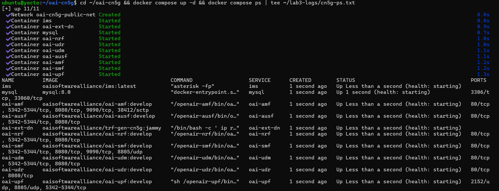

**CN5G initialized** (all containers `healthy` about 9 minutes later):

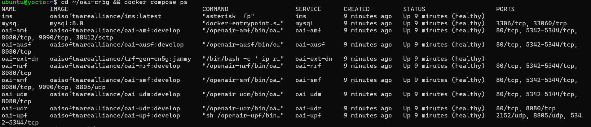

**gNB NG Setup** with the AMF (PLMN 001/01, SST 1):

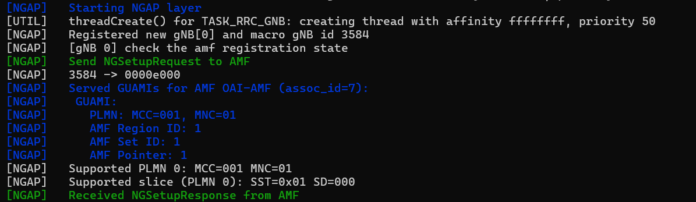

**UE synchronization, random access and RRC Setup** (PCI 0, SIB1 decoded, 4-step CBRA succeeded, `NR_RRC_CONNECTED`). The UE also prints the TDD pattern from SIB1: 5 ms period, 7 DL slots + 6 DL symbols, 2 UL slots + 4 UL symbols, the same DL-heavy pattern analysed in Lab 2.

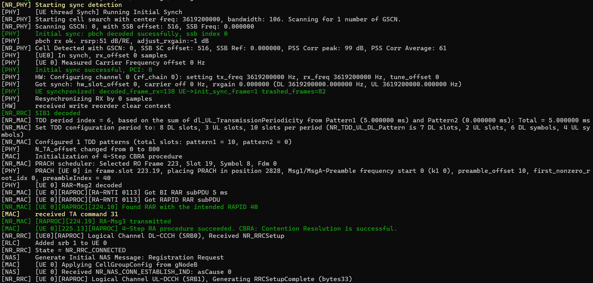

**UE Registration, PDU Session and tunnel on the UE side**:

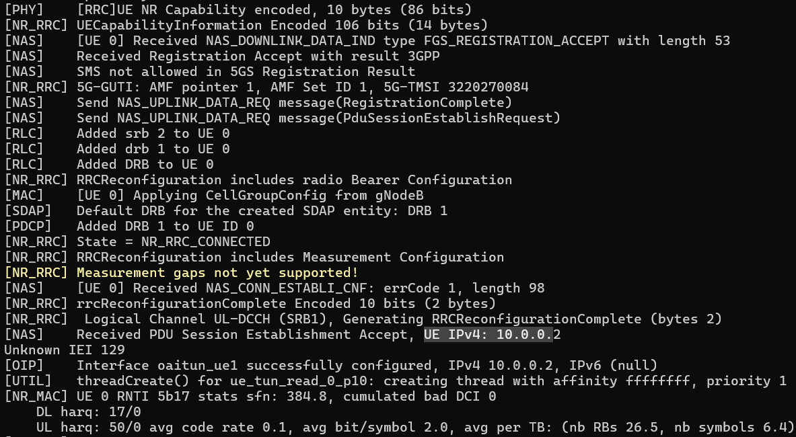

**gNB side**: RRC_CONNECTED for RNTI 5b17, PDU Session 10, DRB 1 and the GTP-U tunnel to the UPF (192.168.70.134):

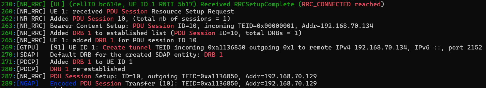

**Core network view**: the AMF lists IMSI 001010000000001 as `5GMM-REGISTERED` on PLMN 001/01, which confirms Registration from the 5GC side and not only from the UE log:

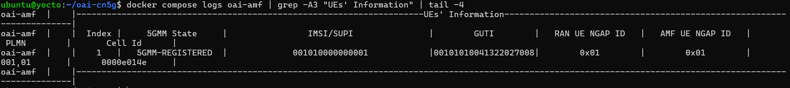


**Q1. Does a successful NG Setup guarantee that a UE can register?**
No. NG Setup only proves that the gNB and the AMF can talk to each other over N2 (SCTP/NGAP) and agree on the served PLMN and TAI. Registration is a per-UE procedure: the AMF still has to find the subscriber, run authentication through the AUSF and UDM, and complete NAS security. A wrong IMSI, wrong key/OPc, wrong PLMN or slice (S-NSSAI), or a missing subscriber entry makes Registration fail even when NG Setup succeeded.

**Q2. Why can the UE establish an RRC connection but still fail Registration?**
RRC is a radio-level procedure between the UE and the gNB only. The gNB accepts an RRC Setup without checking who the subscriber is, because the UE identity is carried inside the NAS Registration Request, which the gNB just forwards to the AMF. The decision to accept the UE is made later by the core (AMF, AUSF, UDM), so a UE can be RRC_CONNECTED and still receive a Registration Reject or an authentication failure.

**Q3. What additional procedure is required after Registration before user data can be exchanged?**
A PDU Session Establishment. The SMF selects a UPF, allocates the UE IP address, sets up the N4 rules on the UPF and the GTP-U tunnel on N3, and the gNB sets up a data radio bearer (DRB) for the session. Only then does the UE create the `oaitun_ue1` interface and can send IP packets.

---

## Task 2 — Investigate RFsimulator Communication

| Item | Observed Value |
|---|---|
| gNB process ID | 2903524 (`nr-softmodem`, owns the listening and connected sockets) |
| nrUE process ID | 2906725 (`nr-uesoftmodem`, owns the client socket) |
| RFsimulator transport protocol | TCP (`ss -t`), over the loopback interface 127.0.0.1 |
| RFsimulator port | 4043 (gNB side); UE uses ephemeral port 53526 |
| TCP connection state | `LISTEN` on `*:4043` (gNB) and `ESTAB` 127.0.0.1:53526 ↔ 127.0.0.1:4043 |
| Connected process(es) | `nr-uesoftmodem` (pid 2906725, fd 91) ↔ `nr-softmodem` (pid 2903524, fd 95) |

```text
ESTAB  368712 0       127.0.0.1:53526           127.0.0.1:4043            users:(("nr-uesoftmodem",pid=2906725,fd=91))
ESTAB  0      122904  [::ffff:127.0.0.1]:4043   [::ffff:127.0.0.1]:53526  users:(("nr-softmodem",pid=2903524,fd=95))
LISTEN 0      5       *:4043                    *:*                       users:(("nr-softmodem",pid=2903524,fd=93))
```

Observations:

- The gNB is the RFsimulator **server**: it listens on `*:4043` (an IPv6 dual-stack socket, so the IPv4 peer appears as `::ffff:127.0.0.1`). The UE is the **client** because it was started with `--rfsimulator.serveraddr 127.0.0.1`.
- Both ends of the same TCP connection are visible because the gNB and UE run on the same VM.
- `pgrep` shows two PIDs per program. `ps -o pid,ppid` shows the chain `sudo (2903521) → sudo (2903523) → nr-softmodem (2903524) → nr-softmodem (2903526)`, and the same for the UE (`2906725 → 2906726`). The first `nr-softmodem` / `nr-uesoftmodem` process owns the sockets; the second is its child.
- The queues are not empty at the moment of capture: 368,712 bytes waiting in the UE receive queue and 122,904 bytes in the gNB send queue. This shows that the link continuously carries a large stream of IQ samples, even when the UE sends no user data.

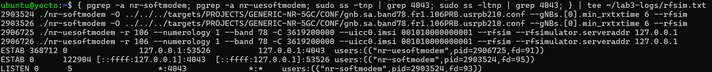

**Q1. Why does RFsimulator use a TCP connection instead of a physical antenna?**
RFsimulator replaces the RF front end (for example a USRP) with a software device. Instead of converting baseband samples to radio waves, the gNB and UE write their time-domain IQ samples into a socket. TCP is used because it is reliable and ordered, works on one host or across hosts, and needs no hardware, so the whole 5G stack can be tested on an ordinary machine.

**Q2. Are the TCP packets exchanged by RFsimulator the same as the UE's application-layer IP packets?**
No. RFsimulator carries IQ samples, which are the output of the full physical layer (coding, modulation, OFDM). A ping packet from `oaitun_ue1` first goes through SDAP, PDCP, RLC, MAC and PHY, and only the resulting samples are carried by the TCP stream on port 4043. The ping itself is visible as IP inside GTP-U on the N3 interface between the gNB and the UPF, not on the RFsimulator socket.

**Q3. Does using RFsimulator mean that the UE and gNB are performing no physical-layer processing?**
No. Both sides still run the NR PHY: channel coding (LDPC/Polar), modulation, OFDM (I)FFT, synchronization with PSS/SSS, channel estimation and HARQ. Only the radio part is removed: there is no DAC/ADC, no RF up/down-conversion and no antenna, and by default the channel between the two is ideal unless a channel model is configured.

---

## Task 3 — Verify End-to-End Connectivity

| Measurement | Observed Value |
|---|---|
| UE IP address | 10.0.0.2/24 (`inet 10.0.0.2/24 scope global oaitun_ue1`) |
| Destination IP | 192.168.70.135 |
| Packets transmitted | 10 |
| Packets received | 10 |
| Packet loss (%) | 0 |
| Minimum RTT (ms) | 4.121 |
| Average RTT (ms) | 5.271 |
| Maximum RTT (ms) | 6.675 |

The ping header `from 10.0.0.2 oaitun_ue1` confirms the source is the UE address from the PDU session, and `ttl=63` shows one routing hop (the UPF / `oai-ext-dn` path) between the UE and the DN. The mean deviation is 0.912 ms.

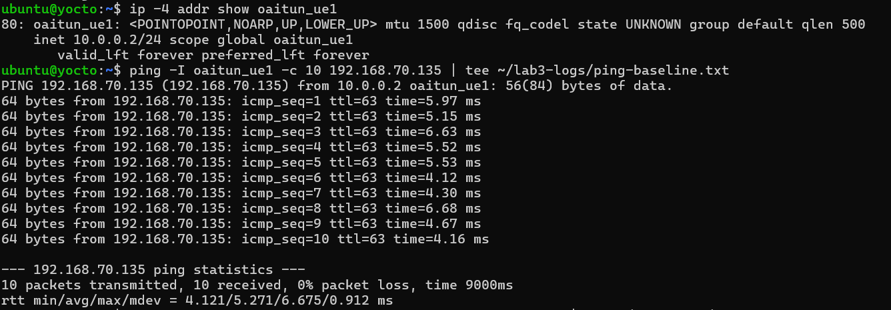

**Q1. Why must Ping use the `oaitun_ue1` interface?**
The UE, gNB and core all run on the same VM, and the VM can already reach 192.168.70.135 directly through the Docker bridge `oai-cn5g`. Without `-I oaitun_ue1` the kernel would use that bridge route and the packet would never enter the 5G system. Binding to `oaitun_ue1` forces the packet to use the UE IP address and go UE → RFsimulator → gNB → GTP-U → UPF → DN.

**Q2. Does successful Registration guarantee successful user-plane connectivity?**
No. Registration only creates the control-plane context in the AMF. User-plane connectivity also needs a successful PDU session (SMF, UPF, N3 tunnel, DRB), a correctly configured tunnel interface on the UE, and a route from the UPF to the data network (NAT or forwarding in the `oai-ext-dn` container). Any of these can fail after Registration has succeeded.

**Q3. What does a successful Ping prove, and what does it not prove?**
It proves that the full chain works in both directions: the UE has an IP address, the radio bearer and the RFsimulator link carry data, the GTP-U tunnel between gNB and UPF is set up, and the UPF can forward to the DN and back. It does not prove anything about real radio performance (coverage, interference, fading), the maximum throughput, or behaviour under load or mobility, because the radio channel is simulated and the RTT is dominated by software processing on one host.

---

## Task 4 — Investigate the Effect of Packet Size

| Scenario | ICMP Payload | Avg. RTT (ms) | Max. RTT (ms) | Packet Loss (%) |
|---|---:|---:|---:|---:|
| A | 56 bytes | 4.822 | 7.001 | 0 |
| B | 512 bytes | 5.642 | 7.594 | 0 |
| C | 1200 bytes | 6.070 | 7.323 | 0 |

```text
RTT Difference = Average RTT(C) - Average RTT(A) = 6.070 - 4.822 = 1.248 ms  (+25.9 %)
```

All three runs used the same registered UE and PDU session, back to back (09:08 to 09:09). Additional statistics computed from the 30 per-packet RTT values of each run:

| Scenario | IP packet size | Min (ms) | Median (ms) | Std. dev. (ms) | Packets > 6 ms |
|---|---:|---:|---:|---:|---:|
| A | 84 B | 2.761 | 4.690 | 0.989 | 4 / 30 |
| B | 540 B | 3.707 | 5.700 | 1.003 | 12 / 30 |
| C | 1228 B | 3.652 | 6.055 | 0.763 | 18 / 30 |

The average and median increase with size (A < B < C). The A–C gap of 1.25 ms is larger than one standard deviation of each run (Welch t ≈ 5.5), so it is unlikely to be random noise. The B–C gap (0.43 ms, t ≈ 1.9) is much weaker. The maximum and minimum do not follow the size order: B has the highest maximum and C has a lower minimum than B.

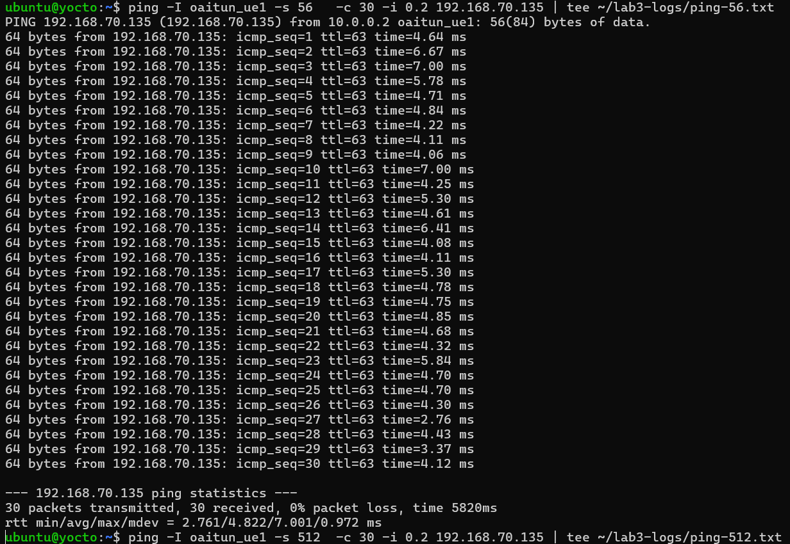

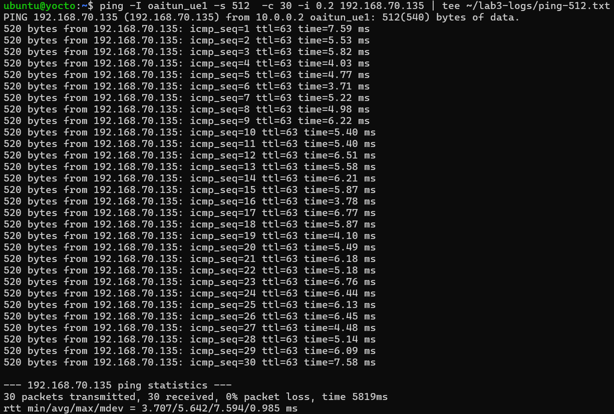

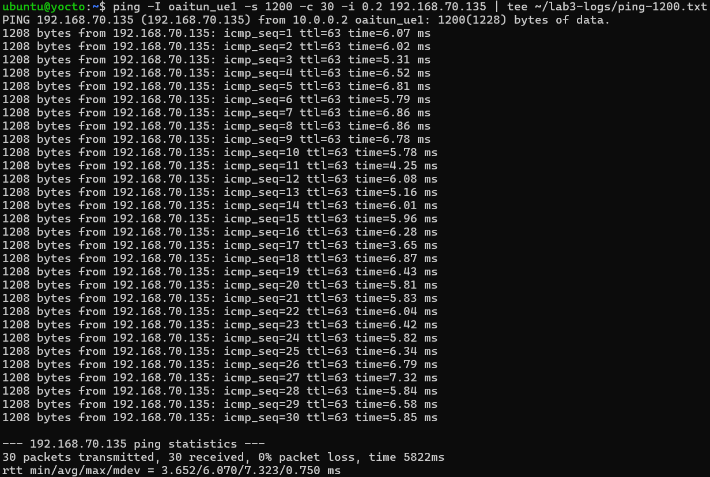

**Q1. Which scenario has the highest average RTT?**
Scenario C (1200 bytes) with 6.070 ms, compared with 5.642 ms for B and 4.822 ms for A. C also has the highest median (6.055 ms) and the most packets above 6 ms (18 of 30).

**Q2. Does increasing packet size always increase RTT in your measurements?**
On average yes, but not for every packet or every statistic. The average rises from 4.822 to 5.642 to 6.070 ms, but the per-packet values of the three runs overlap heavily: C has packets as fast as 3.65 ms and A has packets as slow as 7.00 ms. The maximum RTT is highest for B (7.594 ms), not C, and the minimum of C (3.652 ms) is lower than that of B (3.707 ms). The increase from B to C (0.43 ms) is also much smaller than from A to B (0.82 ms) even though the size step is larger, so the RTT is not proportional to size. The baseline run with the same 56-byte payload but a 1 s interval had an average of 5.271 ms, 0.45 ms higher than Scenario A, which shows that factors other than size change the RTT by a similar amount.

**Q3. Why might a larger packet require more transmission or processing resources?**
A larger packet produces a larger transport block, so the MAC scheduler must give it more PRBs or more slots, and the PHY must run more LDPC code blocks, modulation and FFT work. If the packet does not fit in one grant it is segmented by RLC and needs several transmissions, and the buffer status report and uplink grant cycle may take extra slots. GTP-U encapsulation and the RFsimulator socket also move more bytes.

**Q4. What factors other than packet size could affect RTT in a software-based 5G network?**
The TDD pattern and the time to the next UL slot, scheduling and SR/BSR delay, HARQ retransmissions, `min_rxtxtime`, CPU load and thread scheduling on the VM (the gNB, UE and core share 16 vCPUs), whether the softmodems run in real time, Docker bridge and UPF forwarding, and the ping interval itself.

**Q5. Can these results be interpreted as real over-the-air 5G latency?**
No. There is no propagation, fading, interference or RF hardware delay, and the timing of the simulated radio depends on how fast the host CPU processes samples rather than on a real clock tied to the air interface. The results show the latency of the OAI software stack on this VM, which is useful for comparing configurations, but not the latency a phone would see on a real cell.

---

## Task 5 — Diagnose a Controlled UE Registration Failure

Failed run: same UE command, only `--uicc0.imsi 001010000000099`.

| Item | Observation |
|---|---|
| Modified parameter | `--uicc0.imsi` 001010000000001 → 001010000000099 |
| UE synchronized with gNB? | Yes. `Initial sync successful, PCI: 0` and `SIB1 decoded` (ue-fail.log lines 78, 84) |
| RRC connection established? | Yes. UE: `Received NR_RRCSetup`, `State = NR_RRC_CONNECTED`; gNB: `(UE ID 1 RNTI 153f) Received RRCSetupComplete (RRC_CONNECTED reached)` |
| Registration successful? | No. The AMF sent a Registration Reject; the UE never received a Registration Accept, no PDU session was set up and `oaitun_ue1` was not created |
| Error or rejection evidence | AUSF → AMF: `{"cause":"CONTEXT_NOT_FOUND","detail":"Resource corresponding to User imsi-001010000000099 not found","status":404}`; AMF: `Request Authentication Vectors failure`, `COMM-PROC-INIT -> 5GMM-DEREGISTERED (event: [REGISTRATION_REJECT_SENT])`, NAS message `7e 00 44 03`; UE: `FGS_REGISTRATION_REJECT with length 4` |
| Likely cause | IMSI 001010000000099 is not provisioned in the subscriber database (UDR/MySQL), so the AUSF/UDM cannot find the subscriber and authentication cannot start |

**Failure sequence (timestamps from the AMF log, 2026-11-11 02:13:58 UTC):**

1. `.605` The AMF receives the Registration Request with SUCI in IMSI format and decodes `SUPI imsi-001010000000099`.
2. `.605` No authentication vector exists yet, so the AMF sends `POST http://oai-ausf:8080/nausf-auth/v1/ue-authentications` with `"supiOrSuci":"imsi-001010000000099"`.
3. `.608` The AUSF answers HTTP 404 `CONTEXT_NOT_FOUND` because the UDM/UDR has no record for this user. The whole lookup takes 3 ms.
4. `.608` The AMF logs `Request Authentication Vectors failure`, moves the UE back to `5GMM-DEREGISTERED` and sends a 4-byte Registration Reject `7e 00 44 03`: `7e` = 5GS mobility management, `00` = plain NAS (no security, since authentication never happened), `44` = Registration Reject, `03` = 5GMM cause #3 *Illegal UE*.

Observations that are specific to this setup (reported as seen, not as expected):

- The AMF UE table printed **before** authentication briefly lists IMSI …099 as `5GMM-REGISTERED` (amf-fail.log line 249). This is only the AMF context created on receipt of the request; the table printed after the reject shows `5GMM-DEREGISTERED` (lines 477–481). The final state, not the transient one, is the evidence.
- The OAI nrUE prints `Received Registration reject message too short` and does not decode the cause. It did not retry Registration: it stayed RRC-connected (RNTI 153f, MAC statistics kept running) with no further NAS messages until I stopped it.
- After the UE was stopped, the gNB logged `UE 153f: request release after UL failure timer expiry` and `no AMF for CU UE ID 1: auto-generate release command`. The gNB had no NGAP UE context for this UE, because the AMF never completed the registration.

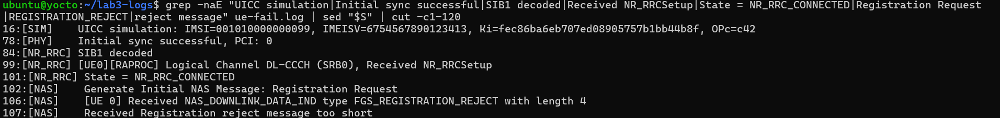

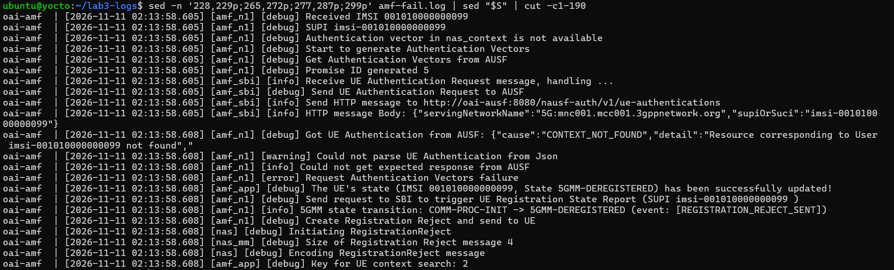

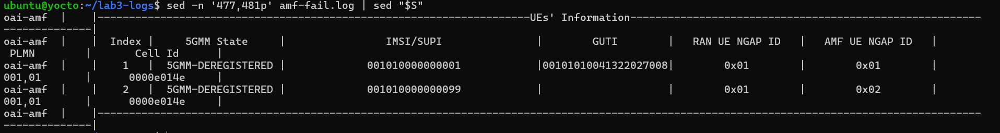

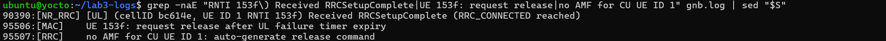

**Recovery.** I restarted the UE with `--uicc0.imsi 001010000000001` and nothing else changed (CN5G and gNB kept running).

| Check | Failed run (…099) | Recovered run (…001) |
|---|---|---|
| Initial sync | Yes (PCI 0) | Yes (PCI 0) |
| RRC connected | Yes (RNTI 153f) | Yes (RNTI b76f) |
| Registration | Reject, cause #3 | `Received Registration Accept with result 3GPP` |
| AMF 5GMM state | `5GMM-DEREGISTERED` | `5GMM-REGISTERED`, new GUTI `00101010041299026702`, AMF UE NGAP ID 0x03 |
| PDU session / tunnel | None | `UE IPv4: 10.0.0.2`, `oaitun_ue1 successfully configured` |
| Ping to 192.168.70.135 | Not possible | 10/10 received, 0 % loss, RTT 3.856 / 4.815 / 5.926 ms |

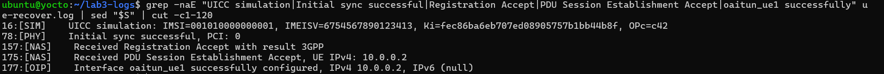

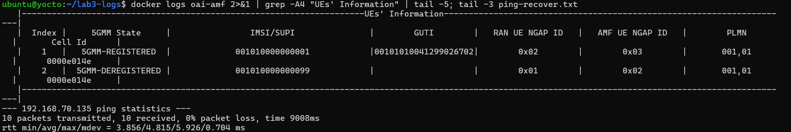

**Q1. Why can the UE potentially synchronize with the gNB even when the IMSI is incorrect?**
Synchronization only uses broadcast signals (PSS, SSS, PBCH/MIB, SIB1) that every UE in the cell can receive, and the following random access and RRC Setup do not check the subscriber identity either. The IMSI is first used inside the NAS Registration Request, which the gNB passes to the AMF without interpreting it.

**Q2. Which network function is involved in UE authentication?**
The AMF starts the procedure and acts as the SEAF, the AUSF runs 5G-AKA, and the UDM (with the UDR as the subscriber database) holds the subscription and generates the authentication vectors. An unknown IMSI is detected when the UDM/UDR cannot find the subscriber.

**Q3. Why does changing an IMSI affect Registration but not the RFsimulator TCP connection itself?**
The RFsimulator TCP connection is set up between the two processes before any 5G procedure, using only the server address and port. It carries IQ samples and knows nothing about subscribers. The IMSI is a NAS-layer identity checked by the core network, several layers above the sample stream.

**Q4. What evidence proves that restoring the correct configuration solved the problem?**
With only the IMSI changed back, every step that failed now succeeds, and the evidence comes from three independent places. The UE log shows `Received Registration Accept with result 3GPP`, `PDU Session Establishment Accept, UE IPv4: 10.0.0.2` and the `oaitun_ue1` interface coming up. The AMF table lists IMSI 001010000000001 as `5GMM-REGISTERED` with a new GUTI, while …099 stays `5GMM-DEREGISTERED`. Finally, the user plane works end to end: the ping over `oaitun_ue1` received 10 of 10 replies with 0 % loss and an average RTT of 4.815 ms, similar to the baseline (5.271 ms).

---

## Task 7 — Relationship Between Simulation and Real 5G

| Feature | OAI RFsimulator | Physical 5G System |
|---|---|---|
| gNB and UE protocol stack | Full NR stack (PHY, MAC, RLC, PDCP, SDAP, RRC, NAS) runs in software | Same protocol stack, in gNB software/hardware and the UE modem |
| OFDM signal processing | Performed in software; IQ samples are sent over TCP | Performed, then converted to RF by DAC/ADC and mixers |
| Physical antennas | None | Required on gNB (often MIMO arrays) and UE |
| RF hardware impairments | None (ideal samples) unless a channel model is enabled | Phase noise, CFO, IQ imbalance, PA non-linearity, ADC quantization |
| Wireless propagation effects | None by default (optional simulated channel and noise) | Path loss, shadowing, multipath fading, Doppler, interference |
| 5G Core connectivity | Real OAI CN5G (AMF, SMF, UPF, ...) over N2/N3 | Real 5G core over N2/N3, same interfaces |

**Q1. Which parts of the 5G system remain functional when physical RF hardware is replaced with RFsimulator?**
Everything above the RF front end: the NR baseband PHY, MAC scheduling and HARQ, RLC, PDCP, SDAP, RRC, NAS, and the complete 5G core including registration, authentication, PDU sessions and the GTP-U user plane.

**Q2. Why is RFsimulator useful for testing the 5G protocol stack?**
It is cheap and reproducible: no SDR, no spectrum license and no shielded room are needed, and the same run gives the same channel every time. Signalling, scheduling and core features can be debugged with full logs on one machine, and it is easy to automate in CI.

**Q3. Why might latency and throughput differ between RFsimulator and a real 5G deployment?**
In RFsimulator the time is driven by how fast the host processes samples, the channel is ideal so there are almost no HARQ retransmissions or MCS changes, and the gNB, UE and core compete for the same CPU. A real system has a fixed air-interface clock, propagation and fading, link adaptation, interference, other users in the cell, and transport delay to the core.

**Q4. What would need to change to test a physical UE instead of OAI nrUE?**
The gNB must use a real radio unit (for example a USRP B210 with `--rfsim` removed and the matching `usrpb210` config), with antennas and a frequency the phone supports. The phone needs a programmable SIM whose IMSI, key and OPc match the subscriber in the core, and the PLMN (for example 001/01), TAC, slice and band in the gNB and core must match what the phone accepts. Transmission must also respect spectrum regulations, for example by using a shielded box.

---

## Final Analysis

1. **From starting the 5GC to user-plane connectivity.**
`docker compose up -d` starts the CN5G containers; the NFs register with the NRF and all ten containers became `healthy`. The gNB then opened an SCTP association to the AMF and completed NG Setup (PLMN 001/01, SST 1). The UE connected to the gNB's RFsimulator socket on port 4043, synchronized on the SSB (PCI 0), read SIB1, performed 4-step random access and the RRC Setup, and sent a NAS Registration Request; the AMF authenticated it through AUSF/UDM, ran Security Mode and sent Registration Accept. Finally the UE requested a PDU session: the SMF allocated 10.0.0.2 and programmed the UPF, the gNB set up DRB 1 and a GTP-U tunnel to 192.168.70.134, and the UE created `oaitun_ue1`, over which ping to 192.168.70.135 succeeded.
2. **RFsimulator TCP connection vs. 5G PDU Session.**
The RFsimulator TCP connection (127.0.0.1:53526 ↔ 127.0.0.1:4043) is a software replacement for the radio channel: it carries time-domain IQ samples between the two processes and exists before any 5G procedure starts. A PDU session is a 5G core concept: a logical user-plane connection between the UE and a data network, with an IP address (10.0.0.2), QoS flows, a DRB on the radio side and a GTP-U tunnel on N3. The PDU session's packets are carried inside the IQ samples after full PHY processing, so the TCP stream is far below the PDU session in the protocol stack. Task 5 shows the difference clearly: with the wrong IMSI the TCP connection and even RRC worked, but no PDU session was ever created.
3. **Effect of packet size on RTT and packet loss.**
Packet loss was 0 % in all three scenarios (30/30 replies each), so size had no visible effect on reliability at this low load. The average RTT increased with size, from 4.822 ms (56 B) to 5.642 ms (512 B) and 6.070 ms (1200 B), a difference of 1.248 ms (+25.9 %) between C and A. The effect was not strictly monotonic for every statistic: B had the highest maximum (7.594 ms), the per-packet values overlapped strongly, and the B–C step was smaller than the A–B step. The 56-byte baseline with a 1 s interval was 0.45 ms slower than Scenario A, so non-size factors such as timing relative to the TDD/scheduling cycle and host load have an effect of similar magnitude.
4. **Registration failure, diagnosis and recovery.**
I restarted only the nrUE with IMSI 001010000000099, which is not in the subscriber database. The UE still synchronized and reached RRC_CONNECTED, which showed that the radio side and RFsimulator were not the problem, but it received a Registration Reject instead of an Accept. The AMF log identified the cause: the AUSF answered `404 CONTEXT_NOT_FOUND ... imsi-001010000000099 not found`, the AMF logged `Request Authentication Vectors failure` and sent a Registration Reject with 5GMM cause #3 (Illegal UE). Restarting the UE with IMSI 001010000000001 restored Registration Accept, the PDU session with 10.0.0.2, `5GMM-REGISTERED` in the AMF and a 10/10 ping.
5. **Two limitations of the simulated environment.**
First, there is no real radio channel: RFsimulator delivers ideal samples over loopback, so there is no path loss, fading, interference or RF impairment (the gNB reported a constant average RSRP of -44 for the UE, and the UE MAC statistics show 0 HARQ errors, e.g. `DL harq: 901/0`). Link adaptation, retransmissions and coverage effects that dominate real 5G performance are therefore absent, and the 0 % loss and stable RTT cannot be generalized to over-the-air conditions. Second, the gNB, UE and all core containers share one 16-vCPU VM, and the simulated air interface runs as fast as the CPU processes samples. RTT values of 4–6 ms therefore reflect software processing and OS scheduling on this host, can change with background load (as the 0.45 ms baseline-vs-A difference shows), and are not comparable to real 5G user-plane latency.
