# Lab 4: 5G CU/DU Split Deployment and F1-C/F1-U Analysis

## Experimental Environment

| Component | Configuration |
|---|---|
| Host | Ubuntu Server 24.04 VM (same VM as Lab 3), no RF hardware |
| OAI RAN | v2.4.0 |
| 5G Core | OAI CN5G (Docker Compose, `~/oai-cn5g`), 10 containers |
| gNB-CU | `nr-softmodem`, `gnb-cu.sa.f1.conf` (name `cu-rfsim`, ID 3584) |
| gNB-DU | `nr-softmodem --rfsim`, `gnb-du.sa.band78.106prb.rfsim.pci0.conf` (name `du-rfsim`, ID 3584) |
| UE | `nr-uesoftmodem`, IMSI 001010000000001, `-C 3450720000` |
| Radio | RFsimulator (IQ samples over TCP, no SDR) |
| Band / SCS / PRB | n78 / 30 kHz / 106 |
| F1 addresses | CU `127.0.0.3`, DU `127.0.0.4` (loopback `lo`) |
| External DN | 192.168.70.135 |
| Capture file | `Lab/Lab4/lab4-f1-complete.pcap` (23 KB, 155 packets, 289 s) |

Commands used (every log was saved with `tee` so each value below can be traced to a file):

```bash
# T1 - CN5G
cd ~/oai-cn5g && docker compose up -d && docker compose ps
# T2 - gNB-CU
sudo ./nr-softmodem -O ../../../targets/PROJECTS/GENERIC-NR-5GC/CONF/gnb-cu.sa.f1.conf 2>&1 | tee ~/lab4-logs/cu.log
# T5 - capture, started BEFORE the DU
sudo tcpdump -i lo -s 0 -nn -w ~/lab4-f1-complete.pcap 'host 127.0.0.3 and host 127.0.0.4 and (sctp or udp port 2152)'
# T3 - gNB-DU
sudo ./nr-softmodem -O ../../../targets/PROJECTS/GENERIC-NR-5GC/CONF/gnb-du.sa.band78.106prb.rfsim.pci0.conf --rfsim 2>&1 | tee ~/lab4-logs/du.log
# T4 - nrUE
sudo ./nr-uesoftmodem -r 106 --numerology 1 --band 78 -C 3450720000 --uicc0.imsi 001010000000001 \
  --rfsim --rfsimulator.serveraddr 127.0.0.1 2>&1 | tee ~/lab4-logs/ue.log
# T6 - traffic
ping -I oaitun_ue1 -c 10 192.168.70.135
ping -I oaitun_ue1 -c 30 -i 0.2 192.168.70.135
```

---

## Task 1 — Inspect the Split Configurations

Output of the `grep` on the two configuration files:

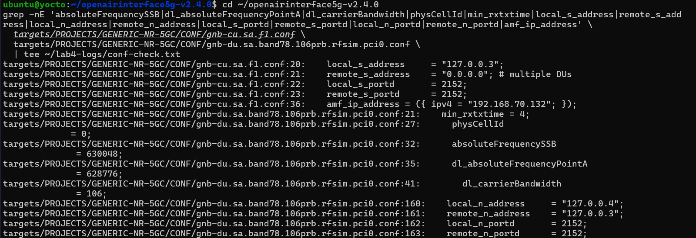

| Item | gNB-CU (`gnb-cu.sa.f1.conf`) | gNB-DU (`gnb-du...pci0.conf`) |
|---|---|---|
| F1 local address | `local_s_address = 127.0.0.3` | `local_n_address = 127.0.0.4` |
| F1 remote address | `remote_s_address = 0.0.0.0` (accepts any DU) | `remote_n_address = 127.0.0.3` |
| F1-U ports | `local_s_portd = remote_s_portd = 2152` | `local_n_portd = remote_n_portd = 2152` |
| AMF | `amf_ip_address = 192.168.70.132` | not used |
| `absoluteFrequencySSB` | not present | 630048 |
| `dl_absoluteFrequencyPointA` | not present | 628776 |
| `dl_carrierBandwidth` | not present | 106 PRBs |
| `physCellId` | not present | 0 |
| `min_rxtxtime` | not present | 4 |

The addresses match the handout. The DU log confirms the frequency conversion: `absoluteFrequencySSB 630048 corresponds to 3450720000 Hz`, and the DU prints the UE command it expects: `Command line parameters for OAI UE: -C 3450720000 -r 106 --numerology 1 --band 78 --ssb 516`. This is the value used for `-C`.

**Q1. Which protocol layers mainly reside in the CU, and which in the DU?**
The CU hosts the higher layers: RRC, SDAP and PDCP (the CU in this OAI setup also terminates N2 towards the AMF and N3 towards the UPF). The DU hosts the lower layers: RLC, MAC and PHY (high and low PHY, in the RFsimulator case the IQ interface to the UE).

**Q2. What is the purpose of the F1 interface?**
F1 connects the CU and DU into one logical gNB. F1-C (F1AP over SCTP) carries control signalling: F1 Setup, cell configuration, relaying of RRC messages and UE context management. F1-U (GTP-U over UDP) carries the user-plane PDCP PDUs of each DRB between the two nodes.

**Q3. Why must the UE frequency be compatible with the DU rather than taken from Lab 3?**
The UE searches for the SSB at the frequency given by `-C`. The Lab 3 gNB used `absoluteFrequencySSB = 641280` (3619.2 MHz, `-C 3619200000`), while this DU uses 630048 (3450.72 MHz). With the Lab 3 value the UE would look for an SSB at a carrier where the DU transmits nothing, so cell search and SIB1 decoding would fail and the RRC procedures would never start. The UE frequency must follow the DU configuration, which is why `-C 3450720000` was used here.

---

## Task 2 — Deploy the Split 5G SA Network

**CN5G.** All 10 containers started (`up 10/10`; the screenshot was taken right after `docker compose up`, so the status column still reads `health: starting`; the CU connected to the AMF successfully afterwards, see NGSetupResponse below):

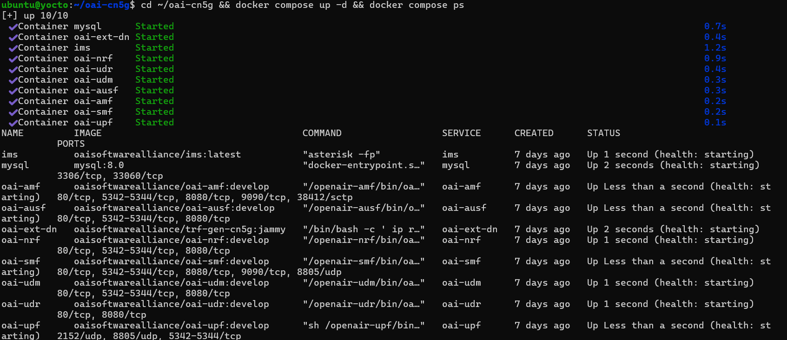

**CU.** The CU first registers with the AMF, then starts F1AP. From `cu.log`: `Send NGSetupRequest to AMF`, `Received NGSetupResponse from AMF` (PLMN 001/01, SST 1), then `Starting F1AP at CU` and `F1AP_CU_SCTP_REQ(create socket) for 127.0.0.3`:

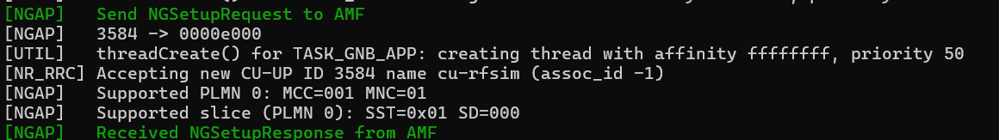

**DU and F1 Setup.** The DU connects to `127.0.0.3` (`F1-C CU 127.0.0.3, binding GTP to 127.0.0.4`). The CU log shows `Received F1 Setup Request from gNB_DU 3584 (du-rfsim)`, `Accepting DU ..., sending F1 Setup Response`, `cell PLMN 001.01 Cell ID 12345678 is in service`. The DU log shows `received F1 Setup Response from CU cu-rfsim` and `received gNB-DU configuration update acknowledge`:

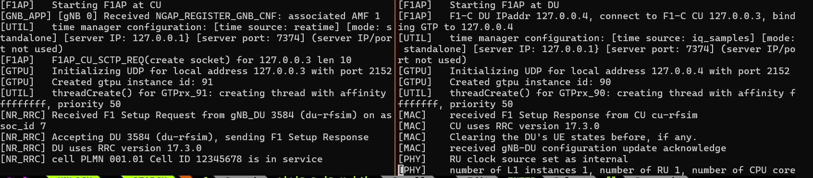

The CU has two separate GTP-U instances (`cu.log`):

| GTP-U instance | Local address | Role |
|---|---|---|
| id 90 | `192.168.70.129:2152` | N3, towards the UPF |
| id 91 | `127.0.0.3:2152` | F1-U, towards the DU |

**UE.** The UE synchronised on the DU cell (`SIB1 decoded`), completed the 4-step RACH (RNTI `fb9e`, `Contention Resolution is successful`), received `Registration Accept`, then `PDU Session Establishment Accept, UE IPv4: 10.0.0.2` and configured `oaitun_ue1`:

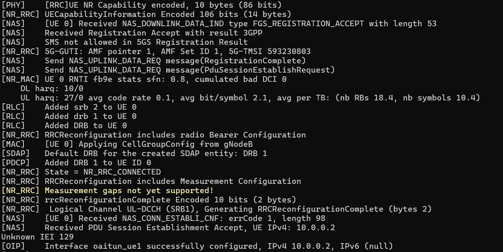

**Tunnel and Ping.** UE IP `10.0.0.2/24` on `oaitun_ue1`:

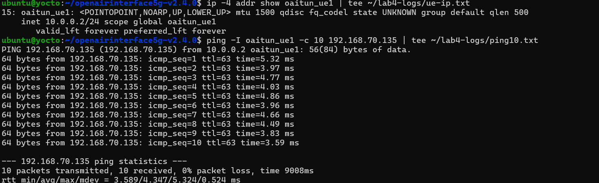

| Run | Sent / Received | Loss | RTT min / avg / max / mdev (ms) |
|---|---|---|---|
| `ping -c 10` (1 s interval) | 10 / 10 | 0 % | 3.589 / 4.347 / 5.324 / 0.524 |
| `ping -c 30 -i 0.2` | 30 / 30 | 0 % | 2.816 / 4.586 / 5.667 / 0.658 |

`ttl=63` shows one routing hop between the UE and the external DN, the same as in Lab 3.

---

## Task 3 — Capture F1-C and F1-U in a Single PCAP

The capture was started after the CU and before the DU, on `lo`, with the filter `host 127.0.0.3 and host 127.0.0.4 and (sctp or udp port 2152)`. The file `lab4-f1-complete.pcap` has 155 packets over 289 s and contains both the SCTP association and the GTP-U packets, so one file covers F1-C and F1-U. The capture starts at the SCTP INIT (frame 1), so the initial F1 Setup is included. N3 traffic is not in the file because it runs on the Docker bridge (`192.168.70.x`) rather than between 127.0.0.3 and 127.0.0.4.

| Content | Packets |
|---|---|
| SCTP (F1-C) | 1 – 48, 50, 74 – 77, 139 – 150, 152 – 155 |
| GTP-U (F1-U) | 86 packets (46 from DU, 40 from CU) |

---

## Task 4 — Analyze F1-C (F1AP / SCTP)

Packet numbers and endpoints below are from `tshark -Y sctp` on the capture (`lab4/sctp.txt`).

| No. | Source → Destination | Message | Meaning |
|---|---|---|---|
| 1 | 127.0.0.4 → 127.0.0.3 | SCTP INIT | DU starts the association |
| 2 | 127.0.0.3 → 127.0.0.4 | INIT_ACK | CU answers |
| 3 | 127.0.0.4 → 127.0.0.3 | COOKIE_ECHO | |
| 4 | 127.0.0.3 → 127.0.0.4 | COOKIE_ACK | Association established |
| 5 | DU → CU | **F1SetupRequest** (carries MIB, SIB1) | DU announces itself and its served cell (PCI 0) |
| 7 | CU → DU | **F1SetupResponse** | CU accepts the DU |
| 9 | DU → CU | GNBDUConfigurationUpdate | DU updates its configuration |
| 10 | CU → DU | GNBDUConfigurationUpdateAcknowledge | |
| 12 – 27 | both | HEARTBEAT / HEARTBEAT_ACK | SCTP keep-alive while the UE is not yet started |
| 28 | DU → CU | **InitialULRRCMessageTransfer** (RRC Setup Request) | First UE message, creates the UE context in the CU |
| 29 | CU → DU | DLRRCMessageTransfer (RRC Setup) | |
| 30 | DU → CU | ULRRCMessageTransfer (RRC Setup Complete + **Registration Request**) | NAS carried inside RRC |
| 31 | CU → DU | DLRRCMessageTransfer (DL Information Transfer, Authentication Request) | |
| 32 | DU → CU | ULRRCMessageTransfer (UL Information Transfer, Authentication Response) | |
| 33 / 34 | CU ↔ DU | NAS Security Mode Command / Complete | |
| 35 / 36 | CU ↔ DU | RRC Security Mode Command / Complete | |
| 37 / 38 | CU ↔ DU | UE Capability Enquiry / Information | |
| 39 – 41 | CU ↔ DU | DL / UL Information Transfer (Registration Accept / Complete, PDU Session Request) | |
| 43 | CU → DU | **UEContextSetupRequest** | Sets up the SRB and DRB 1 (the message contains `SRBs-ToBeSetup-List` and `DRBs-ToBeSetup-List`, dRBID 1) |
| 44 | DU → CU | **UEContextSetupResponse** | DU accepts and returns its F1-U endpoint |
| 45 / 46 | CU ↔ DU | DLRRC (RRC Reconfiguration) / ULRRC (RRC Reconfiguration Complete) | |
| 47 / 48 | CU ↔ DU | UEContextModificationRequest / Response | |

Wireshark screenshots:

- F1 Setup Request and Response (frames 5 and 7):

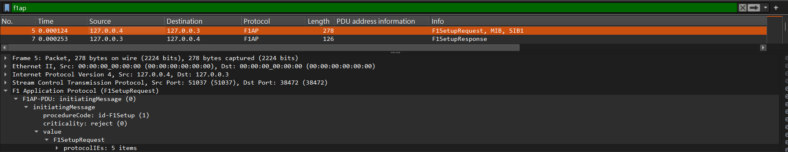

- UE-associated F1AP messages (frames 28 – 48):

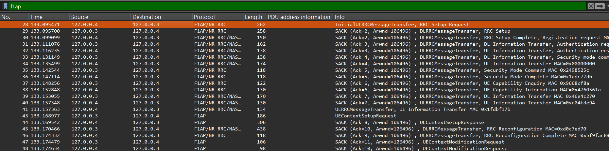

The sequence on the CU log is consistent with this: `Decoding CCCH: RNTI fb9e`, `Create UE context: CU UE ID 1 DU UE ID 64414`, `Send RRC Setup`, `Received RRCSetupComplete (RRC_CONNECTED reached)`, then the NGAP Initial UE Message to the AMF.

**Q1. Which node initiates F1 Setup, and which acknowledges it?**
The DU initiates it (frame 5, F1SetupRequest from 127.0.0.4) and the CU acknowledges it (frame 7, F1SetupResponse from 127.0.0.3). The DU is also the SCTP client that sends the INIT.

**Q2. Difference between SCTP association establishment and F1 Setup?**
The SCTP association (frames 1 – 4, INIT, INIT_ACK, COOKIE_ECHO, COOKIE_ACK) is a transport-layer connection and says nothing about the RAN. F1 Setup (frames 5 – 7) is an application-layer F1AP procedure running on top of that association in which the DU sends its identity, name and served-cell information (PCI, PLMN, MIB, SIB1) and the CU accepts it. The association can exist without F1 Setup being accepted.

**Q3. How can a NAS Registration Request be transported over F1-C?**
The UE puts the NAS message inside an RRC message (`RRCSetupComplete` carries it as `dedicatedNAS-Message`). The DU does not interpret the RRC message; it forwards the PDCP/RRC PDU in an F1AP `ULRRCMessageTransfer` (frame 30). The CU decodes it and forwards the NAS PDU over NGAP to the AMF. Downlink works the same way with `DLRRCMessageTransfer`, for example the Authentication Request in frame 31.

**Q4. What is the role of UE Context Setup?**
It creates the UE-specific resources in the DU. In frame 43 the CU asks the DU to set up the SRB and DRB 1 and gives it the F1-U uplink tunnel endpoint (CU `127.0.0.3`, TEID `0x9004dbd6`); the DU answers in frame 44 with its own DL tunnel endpoint (DU `127.0.0.4`, TEID `0x7d61923b`). Without it the DU has no radio bearer to carry user data and F1-U cannot be used.

**Q5. Does F1 Setup alone prove successful UE Registration?**
No. F1 Setup (frames 5 – 7) only shows that the DU and CU are connected, and it happened before the UE was started (the heartbeats in frames 12 – 27 show the gap). Registration is proved by the NAS messages (Registration Accept in the UE log and the `RRC_CONNECTED` / NGAP lines in the CU log), and end-to-end connectivity is proved by the PDU Session, `oaitun_ue1` and the Ping. Each stage must be checked separately.

---

## Task 5 — Analyze F1-U (GTP-U / UDP)

A GTP-U T-PDU from the capture (frame 49, UL) and one from the downlink (frame 54):

| Field | Frame 49 (DU → CU) | Frame 54 (CU → DU) |
|---|---|---|
| Outer IP | 127.0.0.4 → 127.0.0.3 | 127.0.0.3 → 127.0.0.4 |
| UDP ports | 2152 → 2152 | 2152 → 2152 |
| GTP message type | T-PDU (0xff) | T-PDU (0xff) |
| TEID | `0x9004dbd6` (2416237526) | `0x7d61923b` (2103546427) |
| Frame length | 101 bytes | 149 bytes |

Outer IP/UDP headers (frame 49):

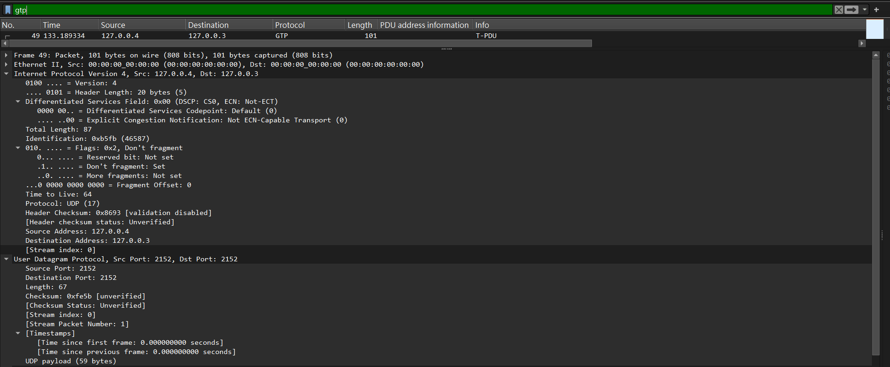

GTP-U header (same frame, message type T-PDU, TEID `0x9004dbd6`):

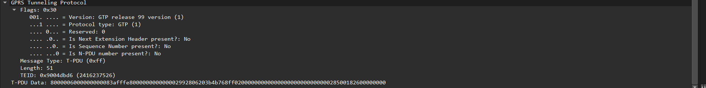

Packet counts, from `tshark -Y gtp` on the same file:

| Direction | Filter | Packets | Frame length |
|---|---|---|---|
| UL, DU → CU | `gtp && ip.src == 127.0.0.4 && ip.dst == 127.0.0.3` | 46 | 40 × 137 B, 6 × 101 B |
| DL, CU → DU | `gtp && ip.src == 127.0.0.3 && ip.dst == 127.0.0.4` | 40 | 40 × 149 B |

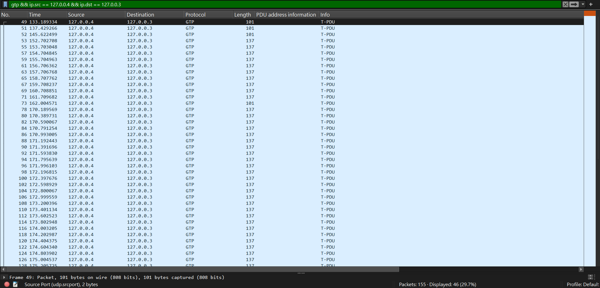

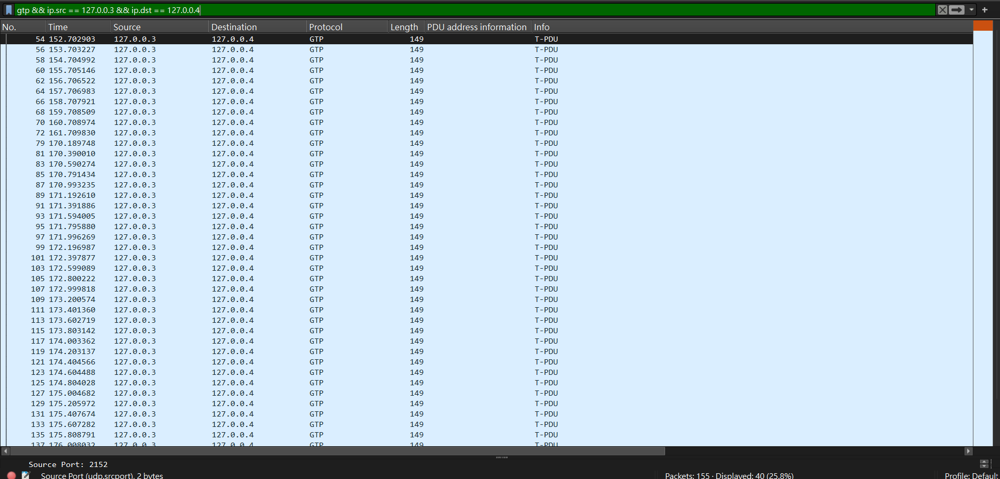

The counts are not equal. The 40 pairs of 137 B / 149 B packets are the ICMP echo requests and replies (10 + 30 pings, all answered). The six extra 101 B uplink packets (frames 49, 51, 52, 73, 138, 151) are sent by the UE without a reply; their payload starts with `86 dd 60 ...` / `3a ff fe 80 ... 85 00`, an IPv6 Router Solicitation (ICMPv6 type 133, to `ff02::2`) from the UE's link-local address. The PDU session is IPv4 only, so the network never answers them.

The F1AP messages in the same PCAP confirm which tunnel is which. The `gTP-TEID` values inside the F1AP UE Context messages are the same numbers seen in the GTP-U headers:

| F1AP frame | Direction | Transport layer address | gTP-TEID | Seen in GTP-U as |
|---|---|---|---|---|
| 43 (UEContextSetupRequest) | CU → DU | 127.0.0.3 | `0x9004dbd6` | UL packets DU → CU |
| 44 (UEContextSetupResponse) | DU → CU | 127.0.0.4 | `0x7d61923b` | DL packets CU → DU |

**Q1. Which transport protocol carries F1-U?**
UDP (port 2152) carrying GTP-U. A lost or reordered packet is not retransmitted at this layer, which suits user data because retransmission is handled by higher layers (e.g. RLC/TCP).

**Q2. What does a GTP-U TEID identify?**
A tunnel endpoint on the receiving side, here one UE bearer (DRB 1 of this UE) in one direction. The receiver picks its TEID and tells the peer in the control plane (F1AP UE Context Setup for F1-U, NGAP/E1 for N3). Hence `0x9004dbd6` is the CU's receive endpoint (all packets sent to the CU carry it) and `0x7d61923b` is the DU's.

**Q3. Which direction is `127.0.0.4 → 127.0.0.3`?**
Uplink: from the DU to the CU. The data the UE sent over the air is received by the DU (RLC/MAC/PHY), passed to the CU (PDCP) over F1-U, and then forwarded on N3 to the UPF.

**Q4. How to distinguish F1-U from N3 in a capture?**
By endpoints, not by the protocol name or port 2152. F1-U is between the DU and the CU F1 address (`127.0.0.4` ↔ `127.0.0.3`); N3 is between the CU's N3 address and the UPF. In this setup the CU log shows two GTP-U instances: `192.168.70.129:2152` (N3, tunnel to `192.168.70.134`, UPF-side TEID `0x1`, CU-side TEID `0xac849dc7`) and `127.0.0.3:2152` (F1-U). The TEID values also differ: F1-U uses `0x9004dbd6` / `0x7d61923b` while N3 uses `0xac849dc7` / `0x1`. Finally, the capture interface and filter matter: this PCAP was taken on `lo` with a filter on 127.0.0.3/127.0.0.4, so it cannot contain N3 packets.

**Q5. Why do F1-C and F1-U use different transport protocols?**
Control signalling needs reliable, ordered delivery with association-level failure detection (F1AP messages must not be lost, and the heartbeats in the capture detect a dead peer), so it uses SCTP. User-plane data is high volume and delay sensitive, and loss recovery is already done by RLC/TCP, so it uses lightweight GTP-U over UDP with no extra retransmission or head-of-line blocking. This also mirrors N2 (NGAP/SCTP) and N3 (GTP-U/UDP).

---

## Task 6 — Compare Monolithic and Split gNB

| Feature | Lab 3: Monolithic gNB | Lab 4: CU/DU Split |
|---|---|---|
| Number of RAN processes | 1 `nr-softmodem` (+ the nrUE) | 2 `nr-softmodem` (CU and DU) (+ the nrUE) |
| Location of RRC/PDCP | Inside the gNB process | gNB-CU |
| Location of RLC/MAC/PHY | Inside the gNB process | gNB-DU |
| F1-C interface present? | No (internal function calls) | Yes, F1AP/SCTP, `127.0.0.4 ↔ 127.0.0.3` |
| F1-U interface present? | No | Yes, GTP-U/UDP 2152, same address pair |
| UE connected to the same 5GC? | Yes, OAI CN5G, PLMN 001/01 | Yes, same CN5G, PLMN 001/01 |
| End-to-end Ping works? | Yes, 10/10 received, avg 5.271 ms | Yes, 10/10 and 30/30 received, avg 4.347 / 4.586 ms |

The two RTT sets come from different runs, so the small difference between them (about 0.7 – 0.9 ms) does not show that either architecture is faster; in Lab 3 alone the average moved by 0.45 ms between runs that differed only in the ping interval.

Splitting the gNB only moves a boundary inside the RAN: the protocol layers are the same, but RRC/PDCP and RLC/MAC/PHY now run in different processes and exchange their data over F1-C and F1-U instead of function calls. The radio side that the UE sees is unchanged, since the DU still transmits the SSB, MIB and SIB1 and the UE still has to find the cell at the right frequency, do RACH and RRC setup. Towards the core the CU still behaves as one gNB (NG Setup, Registration, PDU session on N2/N3), so the UE still needs NAS Registration and a PDU session to get an IP address. The split is invisible to the UE and the 5GC, which is why the same IMSI and the same CN5G worked without any change.

---

## Final Observations

1. **Frequency parameters must match the DU.** The monolithic gNB used SSB 641280 (3619.2 MHz); the split DU uses 630048 (3450.72 MHz), so the UE needed `-C 3450720000`. The DU log prints the UE command it expects.
2. **Bring-up order matters for the capture.** Starting tcpdump before the DU captured the whole SCTP handshake and F1 Setup (frames 1 – 7); starting it later would have missed them.
3. **F1-C carries the whole UE signalling.** Frames 28 – 48 contain RRC Setup, NAS Registration and Authentication, Security Mode, UE Capability, UE Context Setup/Modification and RRC Reconfiguration, all as F1AP RRC Message Transfer or UE Context procedures. The DU forwards the RRC messages without interpreting them.
4. **F1-U tunnel ids come from F1AP.** The TEIDs in the F1AP UE Context messages (`0x9004dbd6` and `0x7d61923b`) are exactly the TEIDs found in the GTP-U packets, which links the control plane to the user plane.
5. **Packet counts are not symmetric.** 46 UL vs 40 DL: six UL packets are unanswered IPv6 Router Solicitations from the UE; the 40 echo request/reply pairs match the 10 + 30 pings with 0 % loss.
6. **F1-U ≠ N3.** Both use GTP-U on port 2152, but the CU runs two GTP-U instances (N3 `192.168.70.129`, F1-U `127.0.0.3`) with different peers and TEIDs; the PCAP was taken on `lo` and only contains F1.
7. **Each stage was verified separately.** F1 Setup (CU/DU logs and frames 5 – 7), Registration (UE log), PDU Session (UE IP 10.0.0.2, `oaitun_ue1`) and Ping (0 % loss) were checked on their own rather than inferred from one another.
