# Lab 5: From Initial Access to RRC Connection Setup

## Evidence Files

| File | Used for |
|---|---|
| `Lab5-ue.log` | UE cell search, synchronization, PRACH, RRC state |
| `Lab5-gnb.log` | gNB-side cross-check of the Random Access procedure |
| `Lab5.pcap` | MIB, SIB1, RAR and RRC messages in Wireshark (MAC-NR) |

All frame numbers below are the frame numbers shown in Wireshark for `Lab5.pcap`; all line numbers are the line numbers of `Lab5-ue.log`.

---

## Task 1: From Cell Search to Msg2 RAR

### Step 1: Cell Search and Initial Synchronization

```bash
grep -nE 'Starting cell search|Initial sync successful' lab5-artifacts/Lab5-ue.log
```

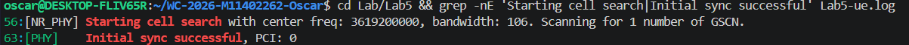

| Item | Value |
|---|---|
| Starting cell search | line 56 (center freq 3619200000 Hz, bandwidth 106 PRB) |
| Initial sync successful | line 63 |
| Synchronization result | **Succeeded** |
| PCI | **0** |

**Explanation.** The UE scans the synchronization raster, detects PSS/SSS, and decodes the PBCH on SSB index 0 (log: `Initial sync: pbch decoded sucessfully, ssb index 0`). After "Initial sync successful, PCI: 0" the UE has the cell's physical-layer identity, downlink time/frequency alignment (frame and symbol timing, carrier-frequency offset of about 2 Hz) and the MIB. So it can now keep receiving downlink, and, using the MIB, locate and decode the PDCCH/PDSCH that carry SIB1. This is the starting point for everything else: without downlink synchronization the UE could not read system information or know when and where to send PRACH.

### Step 2: MIB and SIB1

Wireshark filter: `nr-rrc`

| Message | Frame |
|---|---|
| SIB1 | **1** |
| MIB | **2** |

(They repeat throughout the capture: SIB1 and MIB are recorded as a pair again and again, e.g. frames 1/2, 3/4, 5/6, …; `nr-rrc.mib_element` alone matches many frames.)

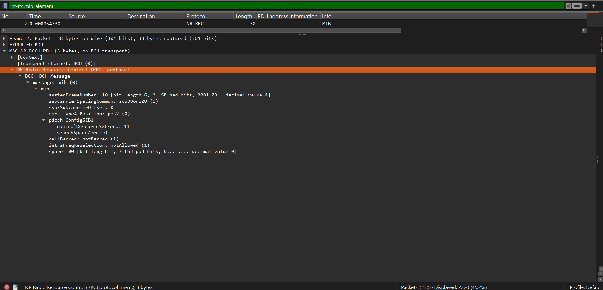

*Frame 2 (filter `nr-rrc.mib_element`): the MIB, carried as `BCCH-BCH-Message` on the BCH transport channel. It is the first RRC message the UE decodes after PSS/SSS. It holds `systemFrameNumber`, `subCarrierSpacingCommon: scs30or120`, `ssb-SubcarrierOffset: 0`, `dmrs-TypeA-Position: pos2`, `pdcch-ConfigSIB1` (`controlResourceSetZero: 11`, `searchSpaceZero: 0`), and `cellBarred: notBarred`.*

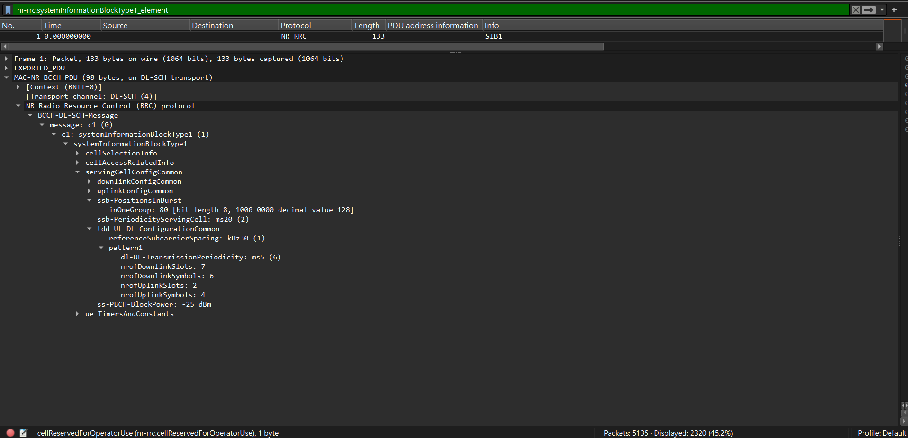

*Frame 1 (filter `nr-rrc.systemInformationBlockType1_element`): SIB1, carried as `BCCH-DL-SCH-Message` on the DL-SCH (broadcast, not addressed to any UE-specific RNTI). It contains `cellSelectionInfo`, `cellAccessRelatedInfo`, `servingCellConfigCommon` and `ue-TimersAndConstants`. The expanded `servingCellConfigCommon` shows the SSB burst (`inOneGroup: 80` → only SSB 0 transmitted, `ssb-PeriodicityServingCell: ms20`), the TDD pattern (`ms5` period, 7 DL slots + 6 DL symbols, 2 UL slots + 4 UL symbols) and `ss-PBCH-BlockPower: -25 dBm`. The RACH parameters (`rach-ConfigCommon`, e.g. `ssb-perRACH-OccasionAndCB-PreamblesPerSSB`, `ra-ContentionResolutionTimer: sf64`) sit inside the collapsed `uplinkConfigCommon`.*

**Purpose.**
- **MIB** is the minimum information needed to find SIB1: the system frame number, the common subcarrier spacing, and the PDCCH configuration (CORESET0 / search space 0) that schedules SIB1. It also says whether the cell is barred, so the UE knows if it may camp on it.
- **SIB1** gives the common configuration needed to access the cell: cell-selection and access information, the downlink/uplink common parameters (TDD pattern, bandwidth parts), and especially the RACH parameters (PRACH occasions, preamble set, power, contention-resolution timer). Without SIB1 the UE would not know when, where or with what parameters to send Msg1.

The UE log confirms the order: `SIB1 decoded` (right after sync) comes before `Initialization of 4-Step CBRA procedure`.

### Step 3: Msg1 PRACH

```bash
grep -nE 'PRACH' lab5-artifacts/Lab5-ue.log
```

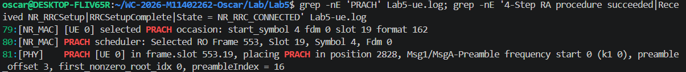

| Item | Value |
|---|---|
| Msg1 log line | line 81 (line 79/80 only select the occasion; line 81 is the actual transmission) |
| `frame.slot` | **553.19** |
| `preambleIndex` | **16** |

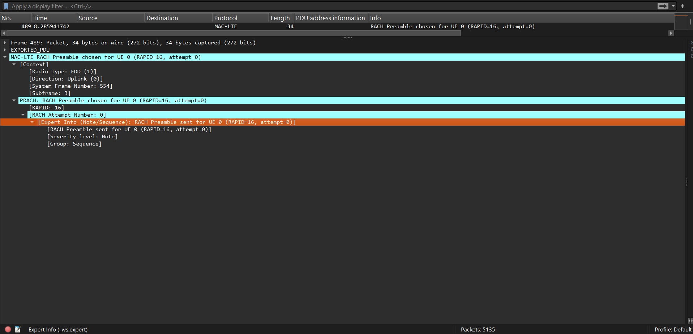

Search term `RACH Preamble chosen` finds **frame 489**: `MAC-LTE RACH Preamble chosen for UE 0 (RAPID=16, attempt=0)`.

| Item | Value |
|---|---|
| gNB tracer `RAPID` | **16** |

*The tracer event is encoded in the old MAC-LTE format, so its context shows `Radio Type: FDD` and `SFN 554 / Subframe 3` instead of NR frame.slot. These are artifacts of the event format and of when the gNB recorded the event, not the actual PRACH occasion (553.19 in both the UE log and the gNB log line `553.19 Initiating RA procedure with preamble 16`).*

**Answers.**
1. This is **Msg1**, the Random Access Preamble of 4-step contention-based random access (UE log: `Initialization of 4-Step CBRA procedure`).
2. The UE log shows transmission at `frame.slot = 553.19` with `preambleIndex = 16` (symbol 4, format 162).
3. Yes, RAPID 16 in Wireshark equals `preambleIndex = 16` in the UE log. The preamble the UE sent was the one the gNB detected (the gNB log also says `Initiating RA procedure with preamble 16`), so both sides refer to the same Random Access attempt, and RAPID is the key that later lets the UE recognize its own RAR.

### Step 4: Msg2 RAR

Search `Random Access Response` / `RAR` finds **frame 490**:
`RAR (RA-RNTI=271) (BI=0) (RAPID=16 TA=0 Temp C-RNTI=61982)`.

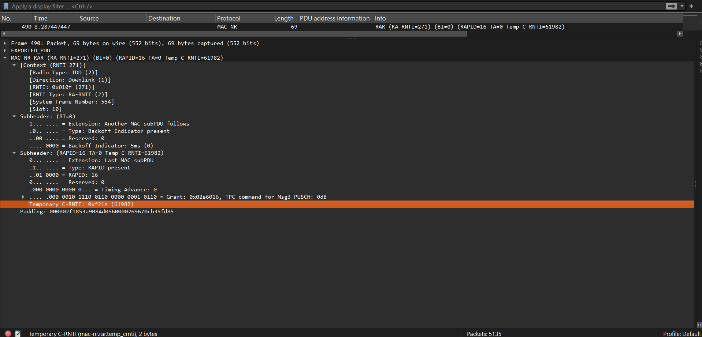

| Item | Value |
|---|---|
| Frame number | **490** |
| RA-RNTI | 271 (0x010f) |
| RAPID | **16** |
| Temporary C-RNTI | **0xf21e (61982)** |
| Timing Advance | 0 |
| UL grant | 0x02e6016 (TPC for Msg3 PUSCH: 0 dB) |
| Backoff Indicator | 5 ms (first subPDU) |

*The RAR is sent at SFN 554 slot 10, addressed to RA-RNTI 0x010f. It has two MAC subPDUs: a Backoff Indicator subheader, and the RAPID subPDU carrying the timing advance, the Msg3 grant and the Temporary C-RNTI.*

*Explanation.* The gNB answers Msg1 on the PDCCH addressed to the RA-RNTI (derived from the PRACH time/frequency occasion), and the RAR carries (a) the RAPID so the UE can see this response is for its preamble (UE log: `Found RAR with the intended RAPID 16`), (b) the timing-advance command, (c) an uplink grant for Msg3, and (d) the Temporary C-RNTI that the UE will use for the rest of the access procedure. The gNB log shows the same values: `UE RA-RNTI 010f TC-RNTI f21e`.

---

## Task 2: Complete Random Access and RRC Connection Setup

### Step 1: RRCSetupRequest (Msg3)

Filter: `nr-rrc.rrcSetupRequest_element`

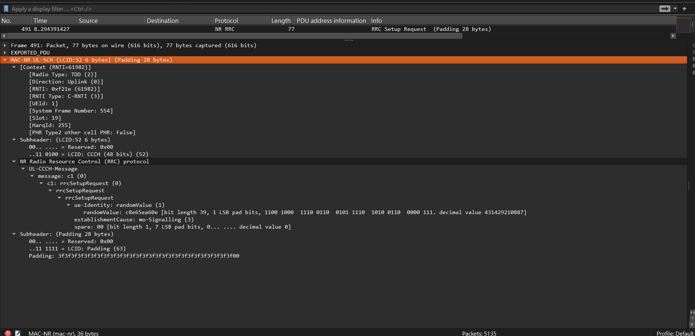

| Item | Value |
|---|---|
| Frame number | **491** |
| Context RNTI | **0xf21e (61982)** |
| ue-Identity | randomValue (random 39-bit value) |
| establishmentCause | mo-Signalling |

*Explanation.* Msg3 is sent at SFN 554 slot 19 in the uplink grant carried by the RAR. It is a `MAC-NR UL-SCH` PDU whose subheader uses `LCID: CCCH (48 bits) (52)`, i.e. a 6-byte `UL-CCCH-Message` on SRB0 carrying `rrcSetupRequest` with `ue-Identity: randomValue` (`c8e65ea60e`) and `establishmentCause: mo-Signalling`.

1. **Yes, it matches.** The Context RNTI 0xf21e is the same as the Temporary C-RNTI in the RAR (frame 490). This shows Msg3 is sent in the grant given by that RAR, using the identity the gNB assigned, so Msg2 and Msg3 belong to the same access attempt.
2. **No.** `RRCSetupRequest` is only a *request*. The gNB may still reject or fail it, and the contention may not yet be resolved (another UE could have sent the same preamble). The connection exists only after the gNB answers with `RRCSetup`, the UE applies it, and the UE answers `RRCSetupComplete`.

### Step 2: RRCSetup (Msg4)

Filter: `nr-rrc.rrcSetup_element`

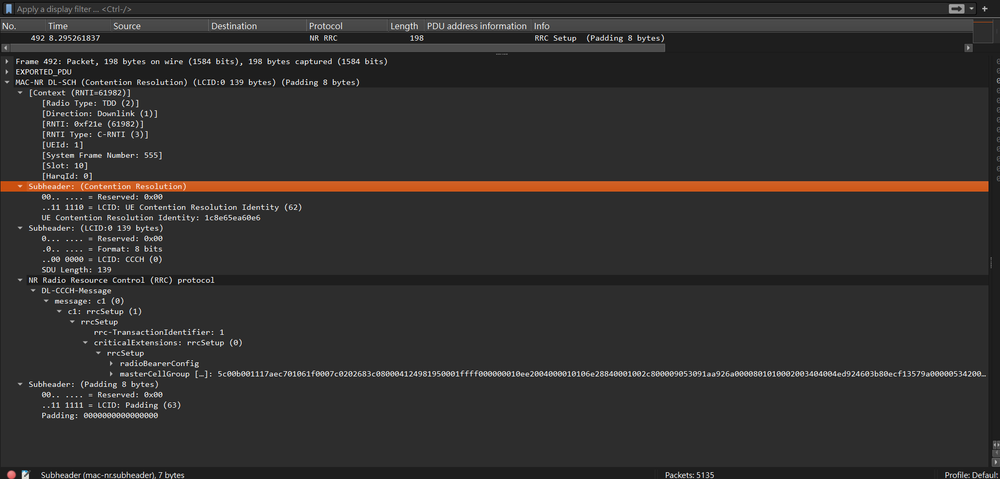

| Item | Value |
|---|---|
| Frame number | **492** |
| Context RNTI | **0xf21e (61982)** |
| `rrc-TransactionIdentifier` | **1** |
| Contention Resolution in the same packet? | **Yes** (`MAC-NR DL-SCH (Contention Resolution)`, UE Contention Resolution Identity `1c8e65ea60e6`) |

**Answers.**
1. This is **Msg4**, the contention-resolution message of 4-step random access.
2. The MAC Contention Resolution Identity and the RRC `RRCSetup` are carried in the same DL-SCH transport block. The MAC CE echoes the UE's Msg3 content (the UE Contention Resolution Identity `1c8e65ea60e6` is 48 bits, exactly the size of the 6-byte CCCH SDU sent in Msg3, so it is a copy of the UE's `RRCSetupRequest` including its random `ue-Identity`). When the UE sees its own identity echoed, it knows it won contention. So winning contention and receiving the RRC configuration (SRB1 configuration, `masterCellGroup`) happen in a single step. The UE log shows this: `4-Step RA procedure succeeded. CBRA: Contention Resolution is successful.` followed by `Received NR_RRCSetup`.

### Step 3: RRCSetupComplete

Filter: `nr-rrc.rrcSetupComplete_element`

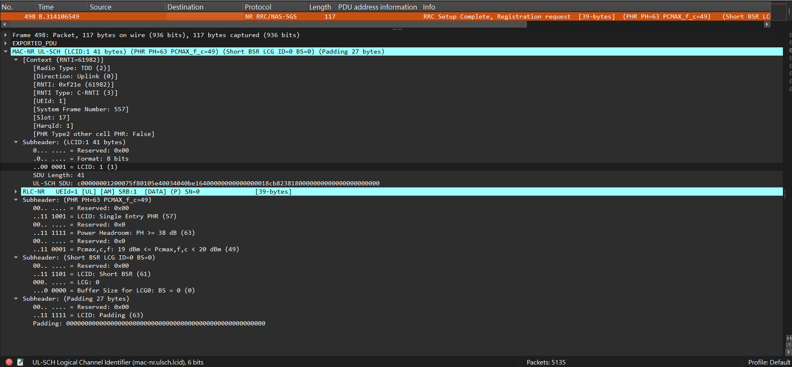

*Frame 498, MAC view: the top layer is `MAC-NR UL-SCH`, with Context RNTI 0xf21e (C-RNTI), SFN 557 slot 17. The RRC message travels on `LCID: 1` (SRB1) in an `RLC-NR [UL] [AM] SRB:1` PDU, together with a PHR MAC CE and a Short BSR MAC CE.*

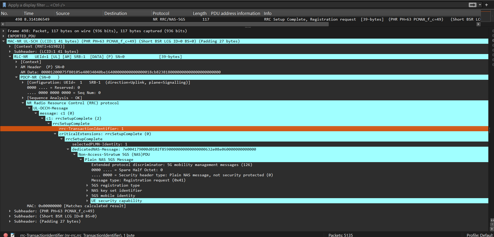

*Frame 498, RRC view: decode path `RLC-NR → PDCP-NR → NR RRC → UL-DCCH-Message → message: c1 → rrcSetupComplete`, with `rrc-TransactionIdentifier: 1`, `selectedPLMN-Identity: 1` and a `dedicatedNAS-Message` that holds a plain (not security-protected) 5GMM `Registration request (0x41)`. The PDCP header shows SRB-1, uplink, signalling plane, `SN=0`, and `MAC: 0x00000000`: AS security is not active yet, so PDCP integrity protection is still null at this stage.*

| Item | Value |
|---|---|
| Frame number | **498** |
| Context RNTI | **0xf21e (61982)** |
| `rrc-TransactionIdentifier` | **1** |
| Dedicated NAS message | 5GMM Registration request (plain NAS) |

**Answers.**
1. Yes, the Context RNTI is still 0xf21e, the Temporary C-RNTI from the RAR. After successful contention resolution it is promoted to the UE's C-RNTI, so one RNTI identifies the UE from Msg2 to RRCSetupComplete.
2. Yes, `rrc-TransactionIdentifier` is 1 in both frame 492 and frame 498. The UE copies the identifier of the RRC message it is answering, so the gNB can match the `RRCSetupComplete` to the `RRCSetup` it sent and discard stale or mismatched responses.

### Step 4: Final Result in the UE Log

```bash
grep -nE '4-Step RA procedure succeeded|Received NR_RRCSetup|RRCSetupComplete|State = NR_RRC_CONNECTED' \
  lab5-artifacts/Lab5-ue.log
```

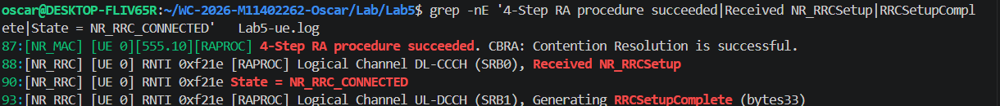

| Event | Line |
|---|---|
| 4-Step RA procedure succeeded | **87** (at 555.10) |
| Received NR_RRCSetup | **88** |
| State = NR_RRC_CONNECTED | **90** |
| Generating RRCSetupComplete | **93** |

**Answers.**
1. In log order: (1) `4-Step RA procedure succeeded` (line 87), (2) `Received NR_RRCSetup` (line 88), (3) `State = NR_RRC_CONNECTED` (line 90); then `Generating RRCSetupComplete` (line 93). The UE enters `RRC_CONNECTED` as soon as it applies RRCSetup and then builds the RRCSetupComplete (which carries the first NAS message, `Registration Request`).
2. `4-Step RA procedure succeeded` proves the **MAC-layer** random access finished: the UE's preamble was answered, Msg3 was received correctly, and contention was resolved in the UE's favour. `State = NR_RRC_CONNECTED` proves the **RRC-layer** state changed: the UE now has an RRC connection with the gNB (SRB1 added, `Added srb 1 to UE 0`) and can exchange dedicated signalling. It does **not** mean the UE is registered with the 5GC. Registration, authentication and PDU session setup are NAS procedures that start after this point (the Registration Request is only now being sent inside RRCSetupComplete).

---

## Task 3: Initial Access MSC

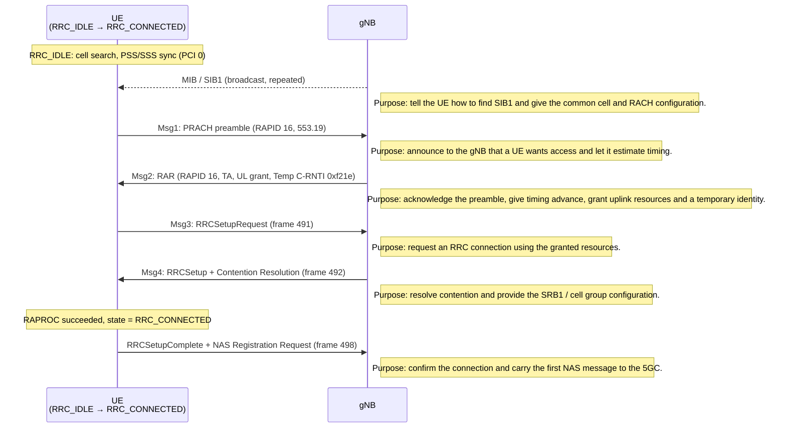

Text version of the same chart:

```text
        UE (RRC_IDLE)                                      gNB
             |                                              |
             |<-------- MIB / SIB1 (broadcast) -------------|  how to find SIB1; common + RACH config
             |--------- Msg1  PRACH preamble 16 ----------->|  request access, let gNB measure timing
             |<-------- Msg2  RAR (Temp C-RNTI 0xf21e) -----|  ack preamble, TA, UL grant, temp identity
             |--------- Msg3  RRCSetupRequest ------------->|  ask for an RRC connection
             |<-------- Msg4  RRCSetup + Contention Res. ---|  contention resolved, SRB1 configured
        UE (RRC_CONNECTED)                                  |
             |--------- RRCSetupComplete (+NAS Reg. Req.) ->|  confirm setup, carry first NAS message
```

| Message | Direction | Frame / log evidence |
|---|---|---|
| MIB / SIB1 | gNB → UE | frames 2 / 1 |
| Msg1 PRACH | UE → gNB | UE log line 81, frame 489 (gNB tracer) |
| Msg2 RAR | gNB → UE | frame 490 |
| Msg3 RRCSetupRequest | UE → gNB | frame 491 |
| Msg4 RRCSetup | gNB → UE | frame 492 |
| RRCSetupComplete | UE → gNB | frame 498 |

**UE states:** before Msg4 the UE is in `RRC_IDLE`; after `RRCSetup` is applied (UE log line 90) it is in `RRC_CONNECTED`. The 5GC Registration that follows is outside this lab.
